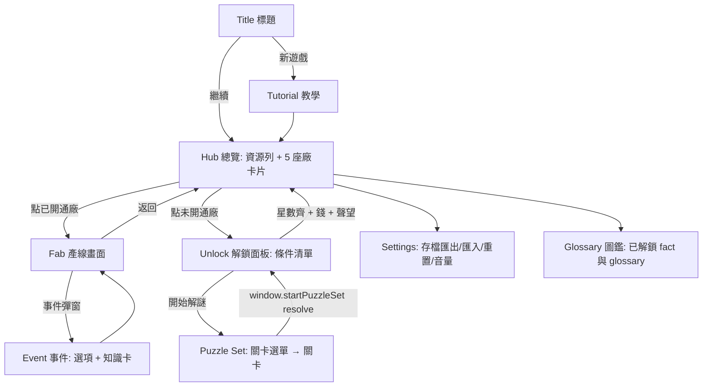

# 《晶圓帝國》Wafer Empire — 設計文件 v1

純 HTML/CSS/JS（ES modules，無打包、無 CDN），部署於 GitHub Pages `/empire`。本文件只談設計，不含程式碼；兩位工程師依 §9 的介面並行實作：
**工程師 P** = `empire/js/puzzle/*`（製程解謎），**工程師 T** = `empire/js/tycoon/*`（經營主迴圈）。

內容來源：`empire/data/content.json`（processes 7、equipment 24、nodes 31、glossary 245、facts 73）。
本文中 `fact#N` 指 `facts[N]`（0 起算），載入器須在讀入時補上 `id = "fact#"+index`，關卡／事件只存 id。

---

## 1. 核心玩法

1. 玩家從 **Fab 1（180 nm）** 起家：買機台、排產線、賣晶圓賺錢。
2. 想開新廠（更新節點，成本與毛利更高）必須先通過該廠的 **製程解謎組（3–5 關）**，再付錢、達到聲望門檻。
3. 解謎星數永久轉成該廠的「初始良率加成」；金錢可買解謎提示。
4. 每個隨機事件、每關結尾都會彈出一條來自 content.json 的真實知識（fact）。

教育目標：玩家玩完能說出「沉積→微影→蝕刻→佈植→CMP→金屬化」的順序與各步驟對剖面的作用。

---

## 2. 畫面流程



- 所有畫面是同一頁的 `<section>`，用 `data-screen` 切換，不使用多頁。URL hash：`#hub #fab/f2 #unlock/f3 #puzzle/f3-2`，供返回鍵與重新整理。
- 解謎畫面為全螢幕覆蓋層，進入時暫停遊戲時鐘（見 §3.6）。

---

## 3. 經營層（工程師 T）

### 3.1 資源
| 資源 | 初始 | 說明 |
|---|---|---|
| 金錢 `money` | 5,000 | 買／升級機台、廠房解鎖、提示、事件處理 |
| 聲望 `rep` | 20（0–100） | 影響售價與解鎖門檻 |
| 晶圓庫存 `inv[fabId]` | 0 | 良品片數；每日結算時賣出，上限 600 片（超出報廢） |

- 單位：1 Lot = 25 片（fact#2）。顯示一律用「片」，產線動畫用 Lot。
- 售價 = 廠基準價 × (0.9 + 0.2 × rep/100) × 市場波動（每日 ±5% 隨機漫步，限 0.9–1.1）。
- 每日需求上限 120 片／廠；賣不掉的留庫存。

### 3.2 五座廠（對應 content.json 的 nodes）
| id | 節點(nodes.name) | 晶圓 | 每片成本 | 基準價 | 標稱毛利(良率=1) | 解鎖金錢 | 解鎖聲望 | 日維運 | D0 | 產線槽數 | 該廠知識 |
|---|---|---|---|---|---|---|---|---|---|---|---|
| f1 | 180 nm | 200 mm | 30 | 60 | 50% | 0（起始） | 0 | 100 | 0.050 | 4 | fact#8 矽與氧化層 |
| f2 | 90 nm | 200 mm | 50 | 115 | 57% | 12,000 | 15 | 300 | 0.060 | 5 | fact#25 熱預算 |
| f3 | 28 nm（成熟製程） | 300 mm | 85 | 220 | 61% | 60,000 | 30 | 900 | 0.070 | 6 | fact#47 成熟製程仍是主力 |
| f4 | 7 nm（EUV 13.5 nm） | 300 mm | 190 | 540 | 65% | 300,000 | 50 | 3,000 | 0.085 | 7 | fact#17 EUV 要真空與反射鏡 |
| f5 | 3 nm（GAA） | 300 mm | 400 | 1,250 | 68% | 1,500,000 | 70 | 9,000 | 0.100 | 8 | fact#46 節點名只是代號 |

- 盈虧平衡良率 = 成本/價 ≈ 0.50 / 0.43 / 0.39 / 0.35 / 0.32，故越新的廠對良率越寬容、但維運與機台更貴。
- 所有數值放 `empire/data/balance.json`（T 維護），程式不得寫死，方便調數。

### 3.3 產線與機台
- 每廠一條線，由 N 個**槽位**依序排列；每槽指定一個製程類別，須放入屬於該類別的機台（取自 content.json `equipment`，只用 `process_id` 非 TODO 者）。
- 槽位模板：
  - f1：清洗 → 薄膜 → 微影 → 蝕刻
  - f2：f1 + 離子佈植
  - f3：f2 + CMP
  - f4：f3 + 金屬化
  - f5：f4 + 第二道微影（槽 8，須 `scanner` 才可放）
- 可選機台（`equipment.id`）與特性（`price` 為 L1 基價，實際 = price × 廠倍率 `[1,2,4,10,25]`）：

| 類別 process_id | 機台 id | price | speed | defMul |
|---|---|---|---|---|
| cleaning | wet_bench / single_wafer_cleaner | 600 / 900 | 1.2 / 1.0 | 1.15 / 0.90 |
| thin_film | furnace / cvd_chamber / pvd_sputter | 700 / 1000 / 900 | 1.3 / 1.0 / 1.0 | 1.20 / 0.95 / 1.00 |
| lithography | coater_developer（f1–f3）/ scanner（f4–f5 必用） | 1200 / 2500 | 1.0 / 1.0 | 1.00 / 0.85 |
| etching | etch_chamber | 1000 | 1.0 | 1.00 |
| ion_implantation | implanter / rta | 900 / 700 | 1.0 / 1.1 | 1.00 / 1.05 |
| cmp | cmp_tool | 1100 | 1.0 | 1.00 |
| metallization | electroplating_tool | 1300 | 1.0 | 1.00 |

- 機台等級 L1–L5。升級費 = price × 廠倍率 × 1.8^L（L=目前等級）。出售退 50% 當前總投入。
- 槽位處理時間 `p = 4 / (speed × (1 + 0.15×(L−1)))` 遊戲小時。線速度由**瓶頸槽**決定：每 `max(p)` 小時投入一個 Lot。
- 空槽 = 產線不通（不投片）；UI 顯示「缺機台」。

### 3.4 良率公式（精確）
對槽位 i（機台等級 `L_i`、機台係數 `defMul_i`）：

```
d_i = D0[fab] × defMul_i × 0.80^(L_i − 1) × (1 − 0.5 × S) × (1 + Σ eventDef)
單槽良率 y_i = 1 − min(d_i, 0.5)
線良率  Y   = clamp( Π y_i × E , 0.05 , 0.99 )
```
- `S` = 該廠解謎星數比 = 已得總星 / (3 × 關卡數)，範圍 0–1（§8 連結）。全三星使缺陷率減半。
- `eventDef`：事件對缺陷率的加算（見 3.5）；`E`：事件對良率的乘數（無事件 = 1）。
- 範例（f1，4 槽皆 L1、defMul=1、S=0、無事件）：y=0.95，Y=0.95⁴=0.815。全 L5 且 S=1：d=0.05×0.4096×0.5=0.01024，Y≈0.96。
- 每個 Lot 出貨時以種子 PRNG（mulberry32，種子存於存檔）對 25 片各抽一次 `rand < Y` 決定良品數，故同一良率仍有手感波動。

### 3.5 隨機事件
每遊戲日每座已開通廠擲一次：8% 觸發（前 3 天保護期不觸發）；事件類型等權重。同廠同時只能有一個事件。

| 事件 id | 效果 | 玩家選項 | 配對知識 |
|---|---|---|---|
| power_outage 停電 | 產線停 1 日；在製 Lot 全部報廢；rep −2 | 無（可預先買「UPS 升級」：fab 一次性 $ 廠倍率×2000，使報廢改為只損失 1 Lot） | fact#54 異常第一步是 Hold |
| particle 微粒污染 | 3 日內 `eventDef += 0.5`（缺陷率 ×1.5）；rep −1 | 「停線清洗」$ 廠倍率×400，停 4 小時後立即解除 | fact#4 人是最大污染源 |
| rush_order 急件 | 3 日內第一個出貨 Lot 以 2.5× 價賣出；但期間產線 `p` ×1.25（急件擠壓其他批） | 接單／拒絕（拒絕無影響） | fact#7 Hot Lot 太多等於沒有急件 |
| tool_failure 機台故障 | 隨機一槽停擺，直到修復；rep −1 | 立刻修復 $ 該機台價×0.15；或等 3 日 | fact#6 保養後須先跑 Qual 才能放行產品 |

- 事件彈窗：標題、效果、選項按鈕，下方「你知道嗎」知識卡（fact 原文，不改寫）。選項決定後才恢復時鐘。
- 聲望每出貨一 Lot：`rep += (Y − 0.75) × 2`（單日加減上限 ±3）。

### 3.6 遊戲時鐘
- 1 tick = 1 遊戲小時；1 日 = 24 tick。`setInterval`：1× = 250 ms／tick，2× = 125 ms／tick；暫停 = `clearInterval`。切速度時清掉重建，不累積誤差（以 tick 計而非以 Date 計）。
- 解謎、事件彈窗、設定、`visibilitychange → hidden` 一律自動暫停；回到頁面不補算（無離線收益）。
- 每 tick：推進 Lot 位置 → 槽位完成事件 → 投新 Lot。每 24 tick：售貨、維運扣款、事件擲骰、自動存檔。
- 產線動畫：每個 Lot 是一個小圖示，沿槽位中心移動；位置由 `progress = elapsedTicks / p` 決定，用 CSS `transform` + `transition: transform <tickMs>ms linear`，暫停時 `animation-play-state` 同步停止。

### 3.7 解鎖與連結
- 解鎖條件（三者全滿足才可按「開廠」）：① 該廠 `puzzleSet` 全關 ≥1 星；② 金錢 ≥ 解鎖金；③ 聲望 ≥ 門檻。開廠扣款一次。
- 星數 → 良率：見 §3.4 的 `S`；T 每次 `startPuzzleSet` resolve 後重算。
- 金錢 → 提示：解謎端呼叫 `EmpireBridge.spendMoney`（§9.2）。

---

## 4. 解謎層（工程師 P）

### 4.1 剖面格
- 12 欄 × 8 列，`grid[r][c]`，r=0 為最上列、r=7 最下列；c=0 最左。
- 材料碼（單字元，亦是 level JSON 用字）：

| 碼 | 材料 | 顏色建議 | 備註 |
|---|---|---|---|
| `.` | 空氣 | 透明 | |
| `S` | 矽基板 | 灰藍 | |
| `D` | 摻雜矽 | 藍紫 | 由 S 佈植而來，不可還原 |
| `O` | SiO₂ | 淺青 | 絕緣 |
| `P` | 多晶矽 | 橙 | 閘極 |
| `M` | 金屬（W/Cu） | 金 | |
| `R` | 光阻（未曝光） | 粉紅 | 犧牲材料 |
| `r` | 光阻（已曝光、可溶） | 淡粉＋斜線 | 暫態，只存在於曝光後～顯影前 |

- 每格同時用「顏色＋圖樣（斜線／點／格）＋單字母」顯示，色盲與黑白螢幕可辨。
- **欄頂** `top(c)` = 該欄最上方非空格的列號；全空欄 `top = 8`。引擎維持不變式：每欄由底部連續堆疊、無懸空（見 strip 的 lift-off 規則）。

### 4.2 工具卡語意（精確的網格轉換）
所有卡每打出一張算 1 步。卡牌參數在打出前於彈出面板選定。**無效或不會改變任何格的步驟被拒絕**（顯示原因 toast、不計步），避免用空步湊數。上限 20 步。

| 卡 | 參數 | 轉換 |
|---|---|---|
| **沉積 deposit** | `mat∈{O,P,M}`、`t∈{1,2,3}` | 每一欄在 `top(c)` 之上疊 `t` 格 mat（保形：凹槽欄跟著長、凸起欄也長）。任一欄 `top(c)−t<0` → 拒絕（溢出）。 |
| **旋塗光阻 spin** | 無 | `m = min_c top(c) − 1`；每欄由列 `m` 到 `top(c)−1` 填 `R`（得到平坦頂面，比最高點高 1 格）。`m<0` 拒絕。 |
| **曝光 expose** | `mask`（關卡提供的光罩 id） | 光罩定義「透光欄」集合；透光欄內所有 `R` → `r`。若透光欄內無任何 `R` 拒絕。（正光阻：曝光處可溶。） |
| **顯影 develop** | 無 | 全部 `r` → `.`。無 `r` 拒絕。 |
| **蝕刻 etch** | `mat∈{S,D,O,P,M}`、`depth∈{1,2,3,4}` | 逐欄：若 `top` 格為 `R`/`r` → 該欄受保護、跳過；否則重複 `depth` 次：若 `top` 格材料 == mat 則移除，否則停止（選擇比 ∞：遇到不同材料即停）。 |
| **離子佈植 implant** | `depth∈{1,2}` | 逐欄：自 `top` 往下連續 `depth` 格，只要是 `S` 就改 `D`；遇到非 `S`（含 `R/r/O/P/M/D`）即停。故光阻、閘極、氧化層皆可擋住佈植（自對準）。 |
| **CMP** | `stop∈` 目前存在的材料 | `r* = min{ r : ∃c, grid[r][c]==stop }`（該材料的最高格列號）；所有 `r < r*` 的非空格移除（整片磨平到 stop 材料最高點）。stop 材料不存在 → 拒絕。 |
| **去光阻 strip** | 無 | 每欄找到最低（最大列號）的 `R/r` 格，移除它與其**上方所有格**（lift-off），其下不動。無 `R/r` 拒絕。 |

衍生規則：
- **移除事件 (removal)**：etch、CMP、strip(lift-off) 每移除一個**非光阻**格記 1 次（R/r 不計）。
- 遊戲簡化聲明（教學文字須註明）：不模擬孔洞、等向蝕刻、擴散；佈植為淺層規則化。

### 4.3 關卡流程與介面
- 版面（375 px）：上 = 目標剖面縮圖（可點放大並排比較）；中 = 目前剖面（即時預覽）；下 = 步驟列（chip 橫向捲動）＋卡牌盤。桌機：左右並排。
- 打出卡：點卡 → 若有參數則彈小面板（材料色塊／厚度／光罩縮圖選擇）→「預覽」格上以半透明顯示結果 → 確認才落地。預覽不計步。
- **復原 undo**：彈出最後一步（無限次、不扣分）；**重做 redo**；**重置**回初始。引擎為純函式重播，步驟陣列即狀態。
- 即時差異提示：目前剖面與目標不同的格以紅色虛線框標示（可在設定關閉）。
- 勝利條件：目前格 == 目標格（無 `R/r` 殘留）。達成後立即結算動畫與知識卡。

### 4.4 星數與「浪費」
- ★1 完成（格完全吻合）。
- ★2 完成且 `steps ≤ par`。
- ★3 完成且 `steps ≤ par` 且 `waste == 0`（星數為累進）。
- `waste = max(0, removals − minRemovals)`：`removals` = 玩家整段步驟中的總移除事件數（§4.2）；`minRemovals` = 關卡預先算好的「最少必要移除數」（等於參考解的 removals，且經 §7.3 驗證為所有解中最小）。直觀意義：沉積多了又磨掉、蝕刻錯又補長，都算浪費材料。
- 使用提示不降低星數，但記錄 `usedHint` 供統計（可選顯示徽章）。
- 同一關重玩取歷史最佳星數。

### 4.5 提示（金錢購買）
價格 = `廠倍率 × 50 × 2^k`（k = 該關已買提示數，0 起）：
1. 提示 1：顯示參考解「下一步」的卡牌種類。
2. 提示 2：顯示該步全部參數（材料／厚度／光罩）。
3. 若玩家目前步驟不是參考解的前綴，提示改為「請先復原到第 j 步」（j = 與參考解首個分歧處），仍收費。
提示費用經 `EmpireBridge.spendMoney` 扣款；錢不足顯示「資金不足」。

---

## 5. 關卡總表（5 廠，共 21 關）

各關 `par` 與 `minRemovals` 由 §7.3 的 solver 自動驗算，下表 par 為預期值。★ 為完整規格範例（§6）。

| 關 | 標題 | 教學重點 | par | 新機制 | 知識 |
|---|---|---|---|---|---|
| f1-1 | 長一層氧化 | 沉積 | 1 | deposit | fact#8 |
| f1-2 | 開窗 | 微影五步 | 5 | spin/expose/develop/etch/strip | fact#18 |
| f1-3 ★ | 氧化層圖形化 | 沉積＋圖形化 | 6 | 光罩二選一 | fact#18 |
| f2-1 | N 井佈植 | 佈植 | 5 | implant、光阻擋佈植 | fact#24 |
| f2-2 | 淺溝隔離 STI | 蝕矽→填氧→磨平 | 8 | CMP stop=S | fact#25 |
| f2-3 | 閘極堆疊 | 多層沉積、選擇性蝕刻 | 8 | 先 etch P 再 etch O | fact#38 |
| f2-4 ★ | MOSFET | 自對準源汲極 | 9 | 閘極當佈植遮罩 | fact#23 |
| f3-1 | 兩次圖形化 | 兩道光罩 | 10 | 多光罩 | fact#36 |
| f3-2 | 接觸孔 | 蝕刻停止於不同材料 | 9 | 選擇比 | fact#21 |
| f3-3 | 鎢栓塞 | 沉積過量＋CMP | 8 | CMP stop=O | fact#26 |
| f3-4 ★ | 銅大馬士革 | 先挖溝再填金屬 | 7 | 恰好填滿＝零浪費 | fact#33/34 |
| f4-1 | 薄氧化＋偽閘極 | 先做假的再換真的 | 12 | 暫時層 | fact#38 |
| f4-2 | 鰭 Fin | 蝕矽成鰭、填氧、磨平 | 10 | 窄圖形 | fact#40 |
| f4-3 | 兩層導線 | 兩次大馬士革 | 14 | 重複模組 | fact#34 |
| f4-4 | 通孔＋導線 | 先通孔後溝槽 | 13 | 部分蝕刻深度 | fact#35 |
| f4-5 | 完整 MOSFET＋金屬 | 前段＋後段 | 16 | 綜合 | fact#36 |
| f5-1…5-5 | 先進整合 | 雙重圖形、全流程限步數、乾淨零浪費挑戰 | 12–18 | 綜合 | fact#46、#39、#43 |

f5 以「限步數＋零浪費」為主，不新增工具卡（GAA 的懸空通道超出本遊戲格模型，作為彩蛋說明文字，不做關卡）。

---

## 6. 範例關卡（完整規格，已用模擬器驗證）

座標：欄 0–11、列 0–7。下列網格第一行 = 列 0。每關底部 3 列（5–7）為 `S`，除非另述。

### 6.1 f1-3 氧化層圖形化（par 6，minRemovals 16）
初始：
```
............   r0
............
............
............
............
SSSSSSSSSSSS   r5
SSSSSSSSSSSS
SSSSSSSSSSSS   r7
```
目標（欄 4–7 留 2 格氧化層，其餘裸矽）：
```
............
............
............
....OOOO....   r3
....OOOO....   r4
SSSSSSSSSSSS
SSSSSSSSSSSS
SSSSSSSSSSSS
```
光罩：`A` 透光欄 0–3、8–11（正解）；`B` 透光欄 4–7（陷阱）。
參考解（6 步）：
1. deposit O t=2（全面長 2 格，rows 3–4）
2. spin（`m = 3−1 = 2`，R 在列 2 全欄）
3. expose A（欄 0–3、8–11 的 R→r）
4. develop
5. etch O depth=2（8 欄 × 2 = 16 次移除；遇矽即停）
6. strip（去除欄 4–7 的 R）
結果吻合目標。removals = 16 = minRemovals → 零浪費。

### 6.2 f2-4 MOSFET（par 9，minRemovals 24）
初始同 6.1；目標：
```
............
............
....PPPP....   r2
....PPPP....   r3  多晶矽閘極
....OOOO....   r4  閘極氧化層
DDDDSSSSDDDD   r5  源/汲極(D) 夾通道(S)
SSSSSSSSSSSS
SSSSSSSSSSSS
```
光罩：`A` 透光欄 0–3、8–11（正解）；`B` 透光欄 4–7（陷阱）。
參考解（9 步）：
1. deposit O t=1（列 4）
2. deposit P t=2（列 2–3）
3. spin（`m = 2−1 = 1`，R 在列 1 全欄）
4. expose A　5. develop
6. etch P depth=2（欄 0–3、8–11 的 P 清掉，停在 O）
7. etch O depth=1（露出矽，欄 4–7 因 R 保護不動）
8. strip（欄 4–7 的 R）
9. implant depth=1（欄 0–3、8–11 頂為 S → D；欄 4–7 頂為 P → 被擋＝自對準）
removals = 16(P) + 8(O) = 24。常見陷阱：漏掉第 7 步（氧化層擋住佈植，欄 0–3 不會變 D）；佈植放在 strip 之前也合法（光阻擋住閘極欄）— 步數相同。

### 6.3 f3-4 銅大馬士革（par 7，minRemovals 24）
初始（Si 兩列＋氧化層兩列）：
```
............   r0–r3 空
............
............
............
OOOOOOOOOOOO   r4
OOOOOOOOOOOO   r5
SSSSSSSSSSSS   r6
SSSSSSSSSSSS   r7
```
目標（欄 4–7 為金屬導線，埋在氧化層內、頂面平坦）：
```
............ ×4
OOOOMMMMOOOO   r4
OOOOMMMMOOOO   r5
SSSSSSSSSSSS
SSSSSSSSSSSS
```
光罩：`A` 透光欄 4–7（正解）；`B` 透光欄 0–3；`C` 透光欄 0–3、8–11。
參考解（7 步）：
1. spin（`m = 4−1 = 3`，R 在列 3 全欄）
2. expose A　3. develop
4. etch O depth=2（欄 4–7 的氧化層清掉，停在矽；depth=3 結果相同，但表示不懂選擇比）
5. strip
6. deposit M **t=2**（溝槽欄長到列 4，剛好填滿；平地欄在列 2–3 上也長 2 格）
7. cmp stop=O（`r*=4`，磨掉列 <4：平地欄 8×2=16 次移除）
removals = 8(etch) + 16(cmp) = 24 → 零浪費。
對照：deposit M t=3 亦可完成（★2），但 CMP 多磨 12 格 → removals=36，waste=12，只得 ★2。
教學文字：真實製程要「過量電鍍」確保填滿（fact#35 底部先長），遊戲簡化為孔洞不會發生，所以最省料的是恰好填滿。

### 6.4 Level JSON 範本
見 §7.1。

---

## 7. 資料結構

### 7.1 Level JSON（`empire/data/levels/<fabId>.json` 為陣列）
```
{
  "schema": 1,
  "id": "f1-3",                 // fabId-序號，全域唯一
  "fab": "f1",
  "order": 3,                   // 在該廠 puzzleSet 中的順序
  "title": "氧化層圖形化",
  "intro": "…",                 // 一至兩句任務說明（繁中）
  "teach": ["thin_film","lithography","etching"],   // content.json processes.id
  "factId": "fact#18",          // 通關後顯示
  "w": 12, "h": 8,
  "init":   ["............", … ×8],   // 每列 12 字元，材料碼見 §4.1，init 不得含 R/r
  "target": ["............", … ×8],
  "cards": [                    // 本關可用的卡與參數範圍（沒列出的卡不出現在卡牌盤）
    {"card":"deposit","mats":["O"],"t":[1,2,3]},
    {"card":"spin"}, {"card":"expose"}, {"card":"develop"},
    {"card":"etch","mats":["O"],"depth":[1,2,3]},
    {"card":"strip"}
  ],
  "masks": [ {"id":"A","open":[[0,3],[8,11]]}, {"id":"B","open":[[4,7]]} ],  // 閉區間欄範圍
  "par": 6,
  "minRemovals": 16,
  "reference": [                // 參考解，同時是提示來源
    {"card":"deposit","mat":"O","t":2}, {"card":"spin"},
    {"card":"expose","mask":"A"}, {"card":"develop"},
    {"card":"etch","mat":"O","depth":2}, {"card":"strip"}
  ],
  "maxSteps": 20,
  "tutorial": null              // 或 tutorial 步驟 id（§10）
}
```
步驟（玩家輸入與 reference 同格式）：`{card, mat?, t?, depth?, mask?, stop?}`。

### 7.2 Save schema（localStorage key `waferEmpire.save`，單一 JSON）
```
{
  "version": 1,                 // 遷移用；讀到舊版走 migrate(v→v+1)，未知新版則拒讀並提示
  "savedAt": 1739000000000,
  "clock": {"tick": 0, "speed": 1, "paused": true},
  "rng": {"seed": 123456789},
  "res": {"money": 5000, "rep": 20, "inv": {"f1":0,"f2":0,"f3":0,"f4":0,"f5":0}, "priceWalk": 1.0},
  "fabs": {
    "f1": {
      "unlocked": true,
      "slots": [ {"equip":"furnace","level":1}, null, … ],   // 長度 = 槽數，null = 空槽
      "ups": false,
      "lots": [ {"slot":1,"progress":0.4,"good":null} ],       // 在製
      "event": null                                            // {"id":"particle","daysLeft":2,"extra":{…}}
    }
  },
  "puzzle": {
    "stars": {"f1-1":3, "f1-2":2},                   // 最佳星數，缺 = 未玩
    "hintsBought": {"f1-2":1}
  },
  "seenFacts": ["fact#18","fact#4"],
  "tutorial": {"done": ["intro","first-puzzle"]},
  "settings": {"sound":0.5,"diffHighlight":true,"reduceMotion":false}
}
```
- 寫入：每遊戲日、每次解謎 resolve、每次購買後；`try/catch` 包住（隱私模式可能丟例外）。
- 設定頁提供「匯出」（下載 .json）、「匯入」、「重置」（二次確認）。

### 7.3 開發驗證工具
`empire/dev/verify.html`（不連入主選單）：載入所有 level JSON，對每關重播 `reference`，斷言 ① 吻合 target ② 步數==par ③ removals==minRemovals ④ `init` 無 R/r ⑤ 所有 `mask` 欄位在 0–11。另提供有界 BFS（深度 ≤ par+1，參數離散）確認沒有更短解、沒有更少 removals 的解；失敗即阻擋合併。

---

## 8. 解謎 ↔ 經營連結

| 方向 | 內容 |
|---|---|
| 星數 → 良率 | `S = Σ stars(該廠各關) / (3 × 關數)`，代入 §3.4。每關最佳星數永久保留。 |
| 通關 → 解鎖 | 該廠 puzzleSet 全關 ≥1 星是開廠必要條件之一。重玩補星不需再付費。 |
| 金錢 → 提示 | §4.5。 |
| 知識 | 通關顯示 `factId`，同時加入 `seenFacts` 並在圖鑑可重看。 |
| 未開通廠的預覽 | 玩家可在聲望／金錢未達時先玩該廠解謎（鼓勵先學後買）。 |

---

## 9. 程式模組與介面

### 9.1 檔案結構
```
empire/
  index.html                  # T 擁有：載入 css 與 js/main.js (type=module)
  DESIGN.md
  css/
    base.css  tycoon.css  puzzle.css    # puzzle.css 全部選擇器前綴 .pz-，tycoon 用 .ty-
  data/
    content.json              # 既有，唯讀
    balance.json              # T：§3 數值
    events.json               # T：§3.5
    levels/f1.json … f5.json  # P
  js/
    main.js                   # T：啟動、載入資料、掛載 puzzle
    shared/                   # T 先交付、之後凍結；P 只能 import 這裡
      bus.js                  # 極簡 pub/sub
      rng.js                  # mulberry32
      storage.js              # load/save/migrate（§7.2）
      content.js              # 載入 content.json、補 fact id、查詢
    tycoon/
      state.js  clock.js  economy.js  yield.js  events.js
      fab-view.js  hub-view.js  unlock-view.js  tutorial.js  bridge.js
    puzzle/
      index.js                # 註冊 window.startPuzzleSet
      engine.js               # 純函式：applyStep(grid,step,level)→{grid,removed,error}；evaluate()
      levels.js               # 載入／驗證 level JSON
      board-view.js  cards-view.js  stars.js  hints.js
      tutorial-hooks.js
  dev/verify.html
```
- 依賴方向：`puzzle/*` 不得 import `tycoon/*`；兩邊唯一耦合 = §9.2 的 window 介面。`engine.js` 無 DOM、無 window，可在 Node／verify.html 直接測。

### 9.2 介面合約
**P 提供（在 `puzzle/index.js` 載入時註冊）：**
```
window.startPuzzleSet(fabId: string, opts?: {
  levelId?: string,                 // 直接進指定關
  mount?: HTMLElement               // 預設 #puzzle-root
}) : Promise<PuzzleResult>

PuzzleResult = {
  fabId: string,
  stars: { [levelId: string]: 0|1|2|3 },   // 本次 session 內有玩到的關的最佳星數；沒玩 = 缺
  cleared: boolean,                         // 該廠所有關是否皆 ≥1 星（含歷史星數）
  hintsBought: { [levelId]: number }
}
```
- Promise 永遠 resolve（玩家按「離開」也 resolve，cleared 依現況），不 reject；fabId 無資料則 reject `Error("no-levels")`。
- 進入時 P 呼叫 `window.EmpireBridge.getStars(fabId)` 取得歷史星數以顯示與取最佳；P **不**自行寫存檔。

**T 提供（`tycoon/bridge.js`，main.js 載入後設定）：**
```
window.EmpireBridge = {
  getMoney(): number,
  spendMoney(amount: number, reason: string): boolean,   // 不足回 false，不扣
  getStars(fabId): { [levelId]: 0|1|2|3 },
  getFactText(factId): string,                           // 取 content.json 原文
  markFactSeen(factId): void,
  pauseClock(): void, resumeClock(): void,               // P 進入／離開時各呼叫一次
  getSettings(): { diffHighlight: boolean, reduceMotion: boolean, sound: number }
}
```
T 在 `startPuzzleSet` resolve 後：寫入星數、重算 `S`、刷新解鎖面板。若 `window.startPuzzleSet` 尚未存在（P 未完成），T 以 stub 回傳 `{cleared:true, stars:{}}` 供單獨開發。

### 9.3 分工與整合順序
1. 第 0 天：T 交付 `shared/*` 與 `bridge.js` stub；P 交付 `engine.js` + level JSON 規格範例 3 關。
2. 並行：P 做 UI／提示／f1–f5 關卡；T 做經濟、產線動畫、事件。
3. 整合驗收：§12 清單。

---

## 10. 教學流程（強制，可跳過）

| 步 | 觸發 | 內容 |
|---|---|---|
| intro | 新遊戲 | 3 句話說明目標；指向 Fab 1 |
| t-buy | Hub | 高亮 Fab 1 槽 1，要求買一台 `wet_bench`（教學中免費）；依序補齊 4 槽 |
| t-run | 槽齊 | 高亮「開始」＋速度鈕；看一個 Lot 走完，顯示良率算式（§3.4 簡化版） |
| t-puzzle | 第一次賣出後 | 彈出「想開 Fab 2 嗎？先過製程挑戰」→ 進 f1-1 |
| t-card | f1-1 | 高亮沉積卡 → 選 O、t=2 → 預覽 → 確認；講解 undo／目標 |
| t-litho | f1-2 | 逐步高亮 spin→expose→develop→etch→strip，每步一句說明（取自 processes.summary） |
| t-star | f1-1 通關 | 解釋三顆星與「浪費」，顯示它如何提高良率 |
| t-event | 首個事件（前三日保護期後強制第一個為 particle） | 引導「停線清洗」並展示知識卡 |

- 教學狀態存 `save.tutorial.done`；設定頁「重看教學」。教學遮罩為一個半透明層＋高亮框，只允許點高亮目標，並提供「跳過」。
- 教學步驟的高亮由 `data-tut="<id>"` 屬性鎖定元素；兩模組各自在自己的元素上標註（P：`data-tut="card-deposit"` 等；T：`data-tut="slot-1"` 等）。

---

## 11. 行動裝置（375 px）與觸控

- viewport：`width=device-width, initial-scale=1`；最小支援寬度 360。側邊留白 16 px，剖面格邊長 = `min(40, floor((viewport−32)/12))`（375 → 28 px，整格寬 336）。
- 觸控目標 ≥ 44×44 px（卡牌、時鐘按鈕、確認／取消）；剖面格本身只讀，不需精準點擊，所有操作走卡牌＋面板。
- 無 hover 依賴：資訊用「點一下展開」；提示、材料圖例固定在可展開的 `<details>`。
- 產線：窄螢幕改為垂直蛇形排列（每槽一列 56 px）；Lot 沿 y 軸移動。寬螢幕橫向。
- 參數面板為 bottom sheet（自底部滑出，含 safe-area-inset-bottom），避免被拇指遮住剖面。
- 步驟列水平捲動 `overflow-x:auto; scroll-snap-type:x proximity`；`touch-action: manipulation` 避免雙擊縮放；整頁 `overscroll-behavior: contain`。
- 不使用拖放；若加入手勢，只作加速（長按卡牌＝說明）。
- `prefers-reduced-motion` 與設定 `reduceMotion`：停用 Lot 補間與勝利動畫，改為跳格。
- 無障礙：每個按鈕 `aria-label`；時鐘狀態 `aria-live="polite"`；事件彈窗為 `role="dialog"`，焦點陷阱與 Esc 關閉。
- 效能：剖面用 12×8 個 DOM 格（96 個），更新只切換 class；不需 canvas。

---

## 12. 驗收清單

- [ ] `verify.html` 全關通過（§7.3）。
- [ ] 6.1–6.3 三個範例以參考解重播得到預期星數與 removals。
- [ ] 良率公式單元測試：表 §3.4 範例（0.815、≈0.96）。
- [ ] 暫停後 tick 不前進；2× 速度下一日耗時約 3 秒；切回分頁不補算。
- [ ] 存檔可往返；`version` 為 2 的檔案被拒讀且有提示；清空 localStorage 仍可玩。
- [ ] `startPuzzleSet` 離開／通關皆 resolve；星數寫入後該廠 `S` 立即更新。
- [ ] 375 px 寬度無水平捲動，所有按鈕可單手點擊。
- [ ] 全部 fact 顯示文字與 content.json 逐字相同。
