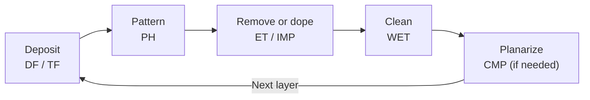

<!-- source: zh-TW/2-process-modules/04-fab-modules/README.md | sha: 3c48565cbac0 -->

# Chapter 4: The Seven Fab Modules — Who Runs Which Part of the Process

> 📍 **Where the wafer is**
>
> - Previous stop: from sand to wafer, a blank wafer is ready to enter the fab
> - **This chapter: meeting the seven modules that run each part of the process**
> - Next stop: lithography, the wafer walks into its first module

---

## Why meet the modules first

Textbooks usually split chapters by technique: oxidation, CVD, annealing, etching, and so on. A fab splits its work by department instead. On the floor, these departments are called **modules**.

It is a bit like a hospital. A medical textbook is organized by organ and disease, but a hospital is organized into internal medicine, surgery and radiology. One patient moves between several departments, and each department handles only its own part.

The wafer is the same. It goes through hundreds of steps in the fab, and every step belongs to a module. Once you understand how the modules divide the work, you can read the production flow of a wafer and know whom to ask when something goes wrong.

> [!NOTE]
> **📖 Term | Module (製程模組)**
>
> - **Definition**: A department in the fab that runs one type of process, including its tools, process engineers and equipment engineers.
> - **On the floor**: People use short names, as in "This step belongs to DF" or "Ask ET about this problem."
> - **Related terms**: route, step, recipe, tool group
> - **Common confusion**: A module is a department, not a technique. The same technique can belong to different modules. For example, an oxide layer can be grown in DF or deposited in TF.

---

## The seven modules at a glance

| Short name | Called on the floor | Main work | Tool type | Chapters |
|---|---|---|---|---|
| PH (Photo) | Photo, "yellow light" (黃光) | Coating photoresist, exposure and development to define patterns | Single-wafer | [Chapter 5](../../2-process-modules/05-lithography/README.md) |
| DF (Diffusion) | Furnace | High-temperature oxidation, LPCVD and annealing | Batch | [Chapter 6](../../2-process-modules/06-thin-films/README.md), [Chapter 8](../../2-process-modules/08-ion-implantation/README.md) |
| TF (Thin Film) | Thin film | PECVD, PVD sputtering, metal CVD and ALD | Mostly single-wafer | [Chapter 6](../../2-process-modules/06-thin-films/README.md), [Chapter 11](../../2-process-modules/11-metallization/README.md) |
| ET (Etch) | Etch | Dry etching and photoresist removal | Single-wafer | [Chapter 7](../../2-process-modules/07-etching/README.md) |
| IMP (Implant) | Implant | Shooting impurities into the silicon | Mostly single-wafer | [Chapter 8](../../2-process-modules/08-ion-implantation/README.md) |
| CMP | CMP, polish | Polishing the wafer surface flat | Single-wafer | [Chapter 9](../../2-process-modules/09-cmp/README.md) |
| WET | Wet, clean | Cleaning, wet etching and photoresist removal | Batch and single-wafer | [Chapter 10](../../2-process-modules/10-cleaning/README.md) |

Companies do not all divide the work the same way. Common differences are that IMP and DF form one department, or that WET is part of DF or ET. Some fabs let each module run its own metrology steps, while others have a separate metrology department.

---

## What each module does

**PH (photo)**: Wafers move automatically between the coat-and-develop track and the scanner. Afterward, the line width and alignment are checked (ADI). If they fail, the photoresist can be stripped and the step redone. PH is the only module where you can start over.

**DF (furnace)**: More than a hundred wafers go into a vertical quartz tube and are heated for several hours. Common processes are:

- **Oxidation**: Growing a pad oxide or a thicker oxide layer.
- **LPCVD**: Depositing silicon nitride, polysilicon or oxide at low pressure and high temperature.
- **Annealing**: Repairing the crystal after implantation, or making a deposited oxide denser.
- **Alloy**: Heating at low temperature in a hydrogen-containing gas near the end of the back end, to repair interface defects.

**TF (thin film)**: Mostly chamber tools that process one wafer at a time. PECVD uses a plasma to help the reaction, so it runs at a lower temperature and can be used after the metal layers. PVD lays down metals by sputtering. Tungsten and ALD are often here too. Some companies also put copper plating under TF.

**ET (etch)**: Uses a plasma to remove material along the photoresist pattern, from trenches and gates to contacts and metal lines. After etching, an oxygen plasma burns off the photoresist, and the line width and defects are checked (AEI).

**IMP (implant)**: Uses different types of implanters depending on the dose and depth. Before implantation, PH usually patterns a photoresist layer to block the areas that should not be hit.

**CMP (polish)**: Polishes an uneven surface flat. Common targets are oxide, tungsten and copper. The polisher has cleaning built in, so the wafer goes in dry and comes out dry.

**WET (wet)**: Cleans or etches with chemical solutions. Examples are the RCA clean before the furnace, removing oxide with HF, and removing silicon nitride with hot phosphoric acid.

> [!NOTE]
> **📖 Term | Furnace (爐管), often called Diffusion (DF) on the floor**
>
> - **Definition**: A vertical high-temperature batch tool that processes more than a hundred wafers at once, used for oxidation, LPCVD and annealing.
> - **On the floor**: "This lot is waiting for DF to fill a batch." "The furnace has to cool down after this run."
> - **Related terms**: LPCVD, annealing, dummy wafer, batching
> - **Common confusion**: "Diffusion" is a historical name. Early fabs used high temperature to diffuse impurities into silicon. Today most doping is done by IMP, and furnaces rarely do diffusion doping anymore.

---

## The same technique can belong to different modules

What confuses beginners most is that the same name shows up in several modules:

| Technique | Where it may be done | Difference |
|---|---|---|
| Oxide layer | DF thermal oxidation, DF LPCVD, TF PECVD | Temperature, quality, and whether it can be used after metal |
| Annealing | DF furnace, RTA tool | A furnace takes a long time; RTA takes only seconds, with a small thermal budget |
| Etching | ET dry etch, WET wet etch | Dry etching can make fine vertical patterns; wet etching is fast but also eats sideways |
| Photoresist removal | ET ashing, WET chemical strip | Often both: ash first, then clean up with a wet step |

So when you see a step, look at both its module and its technique.

---

## Putting it together: a stretch of the route

Take STI (shallow trench isolation), which isolates the transistors, as an example. The wafer moves between modules like this:

**DF → DF → PH → ET → WET → TF → DF → CMP → WET**

1. **DF**: Grow a thin pad oxide to buffer the stress from the next layer.
2. **DF**: Deposit silicon nitride by LPCVD, to act as a hard mask and a polish stop layer.
3. **PH**: Define where the trenches go.
4. **ET**: Etch the trenches, then burn off the photoresist.
5. **WET**: Clean the trench surfaces.
6. **TF**: Fill the trenches with oxide by CVD.
7. **DF**: Anneal to make the fill oxide denser.
8. **CMP**: Polish away the extra oxide, stopping on the silicon nitride.
9. **WET**: Remove the silicon nitride with hot phosphoric acid.

Almost the whole flow of the fab is this loop repeated dozens of times. [Chapter 12](../../3-integration/12-cmos-process-flow/README.md) walks through a complete CMOS flow.

> [!TIP]
> **🔧 Know-how | The module that finds a problem is not always the module that caused it**
>
> - **Situation**: ADI in PH finds a line width shift, or CMP finds uneven film thickness after polishing.
> - **Practice**: Besides checking the step that found the problem, look back through the history of the previous few steps, such as the thickness of the last film, the furnace slot position, and how long the wafer waited after cleaning.
> - **Why**: Every module inherits the result of the step before it. A change in film thickness changes the reflection during exposure. A different trench depth changes the height after polishing.
> - **If you skip it**: Tuning only the step that found the problem just covers up the upstream issue. The real cause is still there, and the next lot will have the same problem.
> - **Related chapters**: [Chapter 17: Yield and Failure Analysis](../../4-yield-and-quality/17-yield-analysis/README.md), [Chapter 19: Handling Abnormalities and Engineering Changes](../../4-yield-and-quality/19-abnormality-handling/README.md)

> [!TIP]
> **🔧 Know-how | Handoffs between modules are where things go wrong most often**
>
> - **Situation**: Wafers finish cleaning in WET, then wait for DF to fill a full batch before entering the furnace.
> - **Practice**: The two modules set the Q-Time together and coordinate dispatching, so that cleaning is timed to match furnace batching.
> - **Why**: Each module sees only its own tools. If cleaning is done too early, the wafers wait too long in between.
> - **If you skip it**: The Q-Time runs out, the surface grows a new oxide or picks up contamination, and the wafers must be cleaned again. The electrical results may even be affected.
> - **Related chapters**: [Chapter 10: Cleaning and Contamination Control](../../2-process-modules/10-cleaning/README.md), [Chapter 24: How Systems Run the Fab](../../6-beyond-the-fab/24-fab-systems/README.md)

---

## Key takeaways

1. Textbooks are organized by technique; fabs are organized by module.
2. The seven main modules are PH, DF, TF, ET, IMP, CMP and WET, and each company divides them a little differently.
3. The furnace (DF) is a high-temperature batch tool for oxidation, LPCVD and annealing.
4. The same technique can belong to different modules, such as oxide layers, annealing, etching and photoresist removal.
5. The wafer goes around the loop of depositing, patterning, removing or doping, cleaning and planarizing again and again.

---

## Further reading

- Hong Xiao, *Introduction to Semiconductor Manufacturing Technology*, the chapters organized by process module
- Michael Quirk and Julian Serda, *Semiconductor Manufacturing Technology*
- Peter Van Zant, *Microchip Fabrication*

---

[← Chapter 3: From Sand to Wafer](../../1-fundamentals/03-sand-to-wafer/README.md) | [Contents](../../README.md) | [Chapter 5: Lithography →](../../2-process-modules/05-lithography/README.md)
