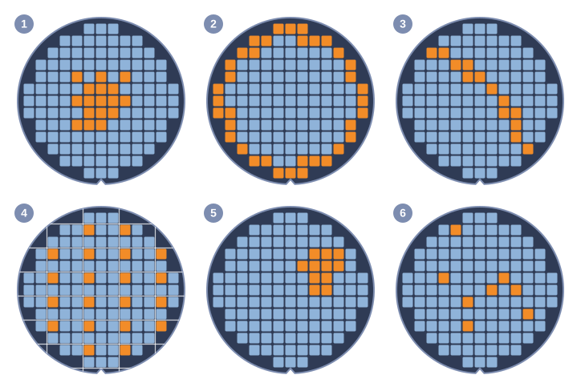

<!-- source: zh-TW/4-yield-and-quality/17-yield-analysis/README.md | sha: a63d0650a5db -->

# Chapter 17: Yield and Failure Analysis — Finding Out Why Chips Fail

> 📍 **Where the wafer is**
>
> - Previous stop: the wafer has finished processing and gone through electrical test
> - **This chapter: analyzing yield and finding out why chips fail**
> - Next stop: feeding the causes back to the process for continuous improvement

---

## Yield is money

The cost of making one wafer is roughly fixed. The more good chips on it, the lower the cost of each chip. So yield directly determines chip cost and the fab's profit.

When a new process first enters volume production, yield is usually low. Engineers find and solve problems one by one, and yield gradually climbs. This process is called the **yield learning curve**. Whoever climbs it faster is more competitive.

---

## How yield is calculated

Yield is usually looked at in several stages:

- **Line yield**: Of the wafers started, how many make it through the front end without being scrapped along the way.
- **Die yield**: On one wafer, what fraction of the dies pass wafer test.
- **Final test yield**: Of the packaged chips, what fraction pass final test.

The overall yield is the product of these stages. For example, 98% × 90% × 99% leaves an overall yield of only about 87%.

> [!NOTE]
> **📖 Term | Yield (良率)**
>
> - **Definition**: The fraction of good products among all products made.
> - **On the floor**: "CP yield on this lot dropped to 80%."
> - **Related terms**: line yield, die yield, final test yield, yield learning curve
> - **Common confusion**: Whenever you hear "yield," first ask which one. A line yield of 98% and a die yield of 98% mean completely different things.

---

## Defects and die size

Think of defects as raindrops falling randomly on the wafer. The bigger the die, the more likely it is to be hit. So with the same defect density, large dies have much lower yield than small ones. This is one reason the industry has recently been splitting large chips into several smaller ones. See [Chapter 22](../../5-backend/22-advanced-packaging/README.md).

<!-- Figure: with the same defect distribution, the yield difference between large and small dies -->

Yield loss falls into two broad types:

- **Random**: For example, particles landing randomly on the wafer. These can only be reduced slowly by improving overall cleanliness.
- **Systematic**: These have a fixed cause, such as a pattern that is especially prone to problems, a misbehaving tool, or poor control at the wafer edge. Find the cause, and the problem can often be solved in one go.

---

## Clues from the wafer map

After wafer test, the pass or fail result of every die is drawn as a **wafer map**. The shape of the failing dies' distribution is often the first clue to the cause.

| Pattern | Likely direction |
|---|---|
| Concentrated at the wafer center | Center-to-edge differences in deposition, etching or polishing |
| A ring, or concentrated at the edge | Process control problems at the wafer edge |
| A straight line or an arc | Scratch |
| The same position in every exposure field | Mask defect or exposure problem |
| A cluster | Local contamination or a local abnormality |
| Randomly scattered | Random defects such as particles |

*Figure: Common wafer map patterns. Blue dies are good and orange dies are bad. ① Concentrated at the center ② A ring at the edge ③ An arc-shaped scratch ④ The same position in every exposure field (white lines mark the field boundaries) ⑤ A cluster ⑥ Randomly scattered.*

> [!NOTE]
> **📖 Term | Wafer map (晶圓圖)**
>
> - **Definition**: A map that shows the test result of every die on a wafer at its position.
> - **On the floor**: "There's a scratch on this wafer's map."
> - **Related terms**: bin, wafer test, defect map
> - **Common confusion**: A wafer map shows electrical test results, while a defect map shows defect inspection results. Overlaying the two shows which defects actually caused chips to fail.

> [!TIP]
> **🔧 Know-how | If every exposure field fails in the same spot, check the mask first**
>
> - **Situation**: On the wafer map, the failing dies appear at the same position in every exposure field.
> - **Practice**: Check the mask used for that layer first, along with the related exposure conditions.
> - **Why**: The scanner uses the same mask for every exposure, so a defect on the mask is "copied" into every exposure field.
> - **If you skip it**: If you treat it as an ordinary random defect, you spend a lot of time looking in the wrong direction, and the bad mask keeps affecting the wafers that follow.
> - **Related chapters**: [Chapter 5: Lithography](../../2-process-modules/05-lithography/README.md)

---

## Commonality analysis

When several lots have unusually poor yield, the most effective first step is to find what these wafers have **in common**. Did they all go through the same tool or the same chamber? Were they processed during the same period? Did they use the same batch of chemicals?

This is called **commonality analysis**, and it relies on the complete history of every wafer recorded by the factory systems. See [Chapter 24](../../6-beyond-the-fab/24-fab-systems/README.md).

> [!TIP]
> **🔧 Know-how | Find what they have in common before looking for the cause**
>
> - **Situation**: Several lots have abnormal yield, but nobody knows why.
> - **Practice**: Compare the low-yield wafers with normal-yield wafers step by step, looking at the tools, chambers, times and materials they went through, and find what only the bad wafers share.
> - **Why**: A wafer goes through hundreds of steps, and it is impossible to investigate every step in detail. Commonality analysis quickly narrows the search to a few steps.
> - **If you skip it**: The investigation wanders without direction, and the problem keeps affecting more wafers.
> - **Related chapters**: [Chapter 7: Etching](../../2-process-modules/07-etching/README.md)

---

## Failure analysis: finding the culprit

Statistical analysis can only tell you "where it might be." In the end, **failure analysis** (FA) is needed to find the physical evidence:

1. **Electrical fault isolation**: Use electrical testing and special imaging techniques to locate the failure on the chip. A failure point often gives off faint light or heat.
2. **Deprocessing**: Remove the material above the chip one layer at a time and look at each layer.
3. **Precise cross-sectioning**: Use a **focused ion beam** (FIB) to cut a cross-section exactly at the failure location.
4. **Observation and analysis**: Examine the structure with an electron microscope and analyze the material composition if needed, to confirm whether it is a short, an open, a void or contamination.

---

## Key takeaways

1. Yield directly determines chip cost, and new processes go through a learning curve as yield gradually climbs.
2. Yield is split into stages such as line, die and final test yield, and the overall yield is their product.
3. The larger the die, the more likely it is to be hit by a defect, and the lower its yield.
4. The shape of the wafer map is the first clue to the cause, and commonality analysis quickly narrows the search.
5. Failure analysis uses electrical fault isolation and physical analysis to find real evidence of the failure.

---

## Further reading

- Gary S. May and Costas J. Spanos, *Fundamentals of Semiconductor Manufacturing and Process Control*, chapters on yield
- EDFAS / ASM International, *Microelectronics Failure Analysis Desk Reference*

---

[← Chapter 16: Metrology and Inspection](../../4-yield-and-quality/16-metrology/README.md) | [Contents](../../README.md) | [Chapter 18: Process Control →](../../4-yield-and-quality/18-process-control/README.md)
