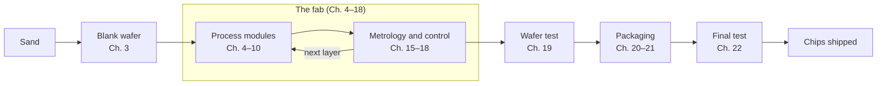

<!-- source: zh-TW/README.md | sha: fa04466ddffc -->

# Introduction to Semiconductor Manufacturing

**Follow one wafer on its journey from sand to chip**

🌐 [简体中文](../zh-CN/README.md) ｜ [繁體中文](../zh-TW/README.md) ｜ **English** ｜ [日本語](../ja/README.md) ｜ [한국어](../ko/README.md) ｜ [Home](../README.md)

---

## What this book is about

A fingernail-sized chip holds billions of transistors. Every one of them is built on a thin silicon wafer through hundreds to more than a thousand process steps over several months.

This book follows **one wafer**. Starting from sand, it travels stop by stop through the fab, passing through lithography, thin films, etching, implantation, polishing and metallization, then on to test and packaging, until it becomes a chip that goes into phones and computers.

The book skips heavy physics and equations and focuses on three things:

- **Process flow**: what each step does, why it is done that way, and why the steps come in that order.
- **Terminology**: the English and Chinese names, and how people in a fab actually use these words.
- **Know-how**: the things textbooks rarely mention but everyone on the fab floor runs into.

## Who it is for

- Readers with a science or engineering background who want to know how chips are made, such as software, firmware and electrical engineers and students.
- Newcomers preparing to join the semiconductor industry who want to learn the process flow and the language of the fab.
- People already in the industry who know their own area well and want to see the whole picture.

No background in semiconductor physics or chemistry is needed. High-school science is enough.

## Three helpers in every chapter

| Marker | What it shows |
|---|---|
| 📍 Where the wafer is | Which stop of the journey the wafer has reached, and what comes before and after |
| 📖 Term box | Definition, how the term is used in the fab, related terms, and what it is often confused with |
| 🔧 Know-how box | What the fab actually does, why, and what goes wrong if you skip it |

Here is a know-how box from Chapter 4, Lithography:

> [!TIP]
> **🔧 Know-how | Lithography is the last chance to start over**
>
> - **Situation**: Inspection finds that the pattern size or alignment is out of spec.
> - **Practice**: Strip off all the photoresist and coat and expose the wafer again. This is called **rework**.
> - **Why**: At this point the wafer has only gained a layer of photoresist. The material underneath has not been touched.
> - **If you skip it**: Once the wafer goes through etching, the wrong pattern is permanently carved into the material, and the wafer may have to be scrapped.

---

## Map of the book

Inside the fab, the wafer goes around the same loop again and again: deposit a material, pattern it with lithography, etch or implant, clean, and measure. Each loop builds one more layer. Chapters 11 to 14 connect these modules into a complete flow, and Chapters 23 and 24 look at the whole journey again from the point of view of factory systems and firmware.

---

## Contents

### Part 0: Before You Start

| Chapter | What you will read |
|---|---|
| [Chapter 0: The Big Picture](0-before-you-start/00-overview/README.md) | The journey of a chip from design to shipment, and how the industry divides the work |
| [Chapter 1: How a Fab Works](0-before-you-start/01-how-a-fab-works/README.md) | Cleanrooms, automated material handling, tools, facilities and the people in the fab |

### Part 1: Fundamentals

| Chapter | What you will read |
|---|---|
| [Chapter 2: From Physics to Transistors](1-fundamentals/02-transistor-basics/README.md) | Semiconductors, doping, MOSFETs and CMOS, only as deep as manufacturing needs |
| [Chapter 3: From Sand to Wafer](1-fundamentals/03-sand-to-wafer/README.md) | Purification, crystal growth, slicing and polishing a perfect blank wafer |

### Part 2: Process Modules

| Chapter | What you will read |
|---|---|
| [Chapter 4: Lithography](2-process-modules/04-lithography/README.md) | Masks, photoresist and scanners: printing the circuit onto the wafer |
| [Chapter 5: Thin Films](2-process-modules/05-thin-films/README.md) | Thermal oxidation, CVD, PVD, ALD and epitaxy |
| [Chapter 6: Etching](2-process-modules/06-etching/README.md) | Dry and wet etching, plasma, selectivity and endpoint detection |
| [Chapter 7: Ion Implantation and Thermal Processing](2-process-modules/07-ion-implantation/README.md) | Dose, energy, annealing and thermal budget |
| [Chapter 8: CMP](2-process-modules/08-cmp/README.md) | Polishing the wafer flat: slurry, dishing, erosion and dummy fill |
| [Chapter 9: Cleaning and Contamination Control](2-process-modules/09-cleaning/README.md) | RCA cleaning, Q-time and cross-contamination |
| [Chapter 10: Metallization](2-process-modules/10-metallization/README.md) | Contacts, copper damascene and low-k dielectrics |

### Part 3: Process Integration

| Chapter | What you will read |
|---|---|
| [Chapter 11: A Complete CMOS Process Flow](3-integration/11-cmos-process-flow/README.md) | FEOL, MOL, BEOL and the number of mask layers |
| [Chapter 12: Advanced Transistor Structures](3-integration/12-advanced-transistors/README.md) | FinFET, GAA and backside power delivery |
| [Chapter 13: Memory Processes](3-integration/13-memory/README.md) | DRAM, 3D NAND and HBM |
| [Chapter 14: What Does "3 nm" Really Mean?](3-integration/14-process-nodes/README.md) | Process nodes, pitches and transistor density |

### Part 4: Quality and Yield

| Chapter | What you will read |
|---|---|
| [Chapter 15: Metrology and Inspection](4-yield-and-quality/15-metrology/README.md) | Film thickness, CD, overlay, defect inspection and sampling |
| [Chapter 16: Yield and Failure Analysis](4-yield-and-quality/16-yield-analysis/README.md) | Reading wafer maps, commonality analysis and failure analysis |
| [Chapter 17: Process Control](4-yield-and-quality/17-process-control/README.md) | SPC, Cpk, R2R and FDC |
| [Chapter 18: Handling Abnormalities and Engineering Changes](4-yield-and-quality/18-abnormality-handling/README.md) | OCAP, holds, MRB and change management |

### Part 5: Back End — Test and Packaging

| Chapter | What you will read |
|---|---|
| [Chapter 19: Wafer Test](5-backend/19-wafer-test/README.md) | WAT and CP: finding the good dies |
| [Chapter 20: Packaging](5-backend/20-packaging/README.md) | Dicing, wire bonding, flip chip and common package types |
| [Chapter 21: Advanced Packaging](5-backend/21-advanced-packaging/README.md) | 2.5D, 3D stacking, hybrid bonding and chiplets |
| [Chapter 22: Final Test and Reliability](5-backend/22-final-test-and-reliability/README.md) | Burn-in, the bathtub curve, reliability tests and failure mechanisms |

### Part 6: Beyond the Fab

| Chapter | What you will read |
|---|---|
| [Chapter 23: How Systems Run the Fab](6-beyond-the-fab/23-fab-systems/README.md) | MES, equipment automation, interlocks and wafer history |
| [Chapter 24: How the Process Shapes Firmware](6-beyond-the-fab/24-process-and-firmware/README.md) | DRAM refresh, Row Hammer, ECC, NAND and chip revisions |

### Appendices

| Appendix | What you will read |
|---|---|
| [Appendix A: Glossary](appendix/glossary.md) | Over two hundred terms in English and Traditional Chinese, with abbreviations |
| [Appendix B: Fab Jargon](appendix/fab-jargon.md) | Everyday expressions heard in a fab, with example sentences |
| [Appendix C: Further Reading](appendix/further-reading.md) | Textbooks, industry standards and conferences |

---

## Reading paths

Reading in order gives you the full picture, but you can also start with the path that fits you:

| Path | Suggested chapters |
|---|---|
| 🚀 Quick overview | Chapters 0, 1, 11 and 14 |
| 💻 Software and firmware engineers | Chapters 0, 2, 11, 13, 14, 22, 23 and 24 |
| 🏭 Joining the industry | The whole book in order, with extra attention to Chapters 1, 11 and 15–18 and Appendix B |
| 📦 Interested in packaging and test | Chapters 0, 11 and 19–22 |

---

## Contributing

This is an open project, and help is always welcome:

- **Found a mistake?** Open an [issue](../../../issues) with the "Erratum" template.
- **Want to add content or figures?** Read the [contributing guide](../CONTRIBUTING.md) and the [style guide](../STYLE_GUIDE.md).
- **Want to translate the book into another language?** Read the [translation guide](../TRANSLATIONS.md).

If this book helps you, please give it a ⭐ star so that more people can find it.

---

## Disclaimer

- This book is based on public information and general industry knowledge. It contains no confidential information, process parameters or internal procedures of any company.
- It is not affiliated with any semiconductor company, and it uses only generic technical terms.
- Most numbers are orders of magnitude or approximate values. Actual values vary by process, product and company.
- If you find anything wrong or out of date, please let us know by opening an issue.

## License

The text and images of this book are licensed under the [Creative Commons Attribution-NonCommercial-ShareAlike 4.0 International License](../LICENSE) (CC BY-NC-SA 4.0). You may share, adapt and translate them for non-commercial purposes, as long as you give credit and share your work under the same license.

The original text is written in Traditional Chinese. If the English and Chinese versions differ, the Chinese version is the reference.
