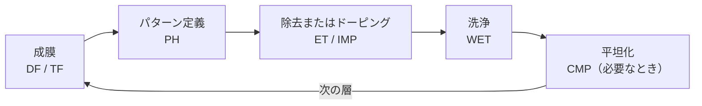

<!-- source: zh-TW/2-process-modules/04-fab-modules/README.md | sha: 3c48565cbac0 -->

# 第 4 章　ファブの 7 つのモジュール：どの部門がどの工程を受け持つか

> 📍 **ウェーハの現在地**
>
> - 前の工程：砂からウェーハへ。まっさらなウェーハがファブに入る準備ができた
> - **この章：工程を分担する 7 つのモジュールを知る**
> - 次の工程：リソグラフィ。ウェーハが最初のモジュールに入る

---

## なぜ先にモジュールを知るのか

教科書はふつう「技術」で章を分けます。酸化、CVD、アニール、エッチングといった具合です。一方、ファブは「部門」で仕事を分けます。この部門を現場では **モジュール** と呼びます。

病院に少し似ています。医学の教科書は臓器や病気ごとに章を分けますが、病院は内科、外科、放射線科に分かれています。1 人の患者がいくつかの科を行き来し、それぞれの科は自分の担当部分だけを受け持ちます。

ウェーハも同じです。ファブの中で数百の工程を通り、どの工程もいずれかのモジュールに属しています。モジュールの分担がわかれば、ウェーハの生産の流れが読めるようになり、問題が起きたときに誰に聞けばよいかもわかります。

> [!NOTE]
> **📖 用語｜モジュール（製程模組）**
>
> - **定義**：ファブの中で、ある種類のプロセスを受け持つ部門。装置、プロセスエンジニア、装置エンジニアを含む。
> - **現場での使い方**：略称で呼ぶことが多い。「この工程は DF の担当だ」「この問題は ET に聞いて」。
> - **関連用語**：ルート、工程（ステップ）、レシピ、装置群
> - **よくある混同**：モジュールは「部門」であって「技術」ではない。同じ技術が別のモジュールに属することもある。たとえば酸化膜は DF で成長させることも、TF で成膜することもある。

---

## 7 つのモジュールの一覧

| 略称 | 現場での呼び方 | 主な仕事 | 装置の形態 | 本書の章 |
|---|---|---|---|---|
| PH（Photo） | フォト、黃光（黄色い光） | レジスト塗布、露光、現像でパターンを定義する | 枚葉式 | [第 5 章](../../2-process-modules/05-lithography/README.md) |
| DF（Diffusion） | 炉 | 高温酸化、減圧 CVD、アニール | バッチ式 | [第 6 章](../../2-process-modules/06-thin-films/README.md)、[第 8 章](../../2-process-modules/08-ion-implantation/README.md) |
| TF（Thin Film） | 成膜 | プラズマ CVD、PVD スパッタ、金属 CVD、ALD | 主に枚葉式 | [第 6 章](../../2-process-modules/06-thin-films/README.md)、[第 11 章](../../2-process-modules/11-metallization/README.md) |
| ET（Etch） | エッチ | ドライエッチング、レジスト除去 | 枚葉式 | [第 7 章](../../2-process-modules/07-etching/README.md) |
| IMP（Implant） | インプラ | 不純物をシリコンに打ち込む | 主に枚葉式 | [第 8 章](../../2-process-modules/08-ion-implantation/README.md) |
| CMP | CMP、研磨 | ウェーハの表面を平らに削る | 枚葉式 | [第 9 章](../../2-process-modules/09-cmp/README.md) |
| WET | ウェット、洗浄 | 洗浄、ウェットエッチング、レジスト除去 | バッチ式と枚葉式 | [第 10 章](../../2-process-modules/10-cleaning/README.md) |

分け方は会社によって少しずつ違います。よくある違いは、IMP と DF が 1 つの部門になっている場合や、WET が DF や ET に含まれている場合です。計測工程は、各モジュールが自分で受け持つファブもあれば、別の部門を置くファブもあります。

---

## 各モジュールの仕事

**PH（フォト）**：ウェーハは塗布現像装置と露光装置の間を自動で搬送されます。終わったら線幅と重ね合わせを検査します（ADI）。不合格ならレジストを剥がしてやり直せます。PH は「やり直せる」唯一のモジュールです。

**DF（炉）**：100 枚を超えるウェーハを縦型の石英炉に入れ、数時間加熱します。主なプロセスは次のとおりです。

- **酸化**：パッド酸化膜や、厚めの酸化膜を成長させます。
- **減圧 CVD**：低圧・高温で、窒化シリコン、ポリシリコン、酸化膜を成膜します。
- **アニール**：イオン注入後に結晶を修復したり、成膜した酸化膜を緻密にしたりします。
- **Alloy**：後工程の終わり近くに、水素を含むガスの中で低温加熱し、界面の欠陥を修復します。

**TF（成膜）**：多くは 1 枚ずつ処理するチャンバー型の装置です。プラズマで反応を助けるプラズマ CVD は温度が低く、金属層のあとでも使えます。PVD はスパッタで金属を成膜します。タングステンや ALD もここで行うことが多いです。銅めっきを TF に含める会社もあります。

**ET（エッチ）**：プラズマを使い、レジストのパターンに沿って材料を取り除きます。トレンチやゲートから、コンタクトや金属配線まで扱います。エッチングのあとは酸素プラズマでレジストを焼き取り、線幅と欠陥を検査します（AEI）。

**IMP（インプラ）**：ドーズ量と深さに応じて、種類の違うイオン注入装置を使います。注入の前には、ふつう PH でレジストのパターンを作り、打ち込んではいけない場所を覆います。

**CMP（研磨）**：凹凸のある表面を平らに削ります。よく扱うのは酸化膜、タングステン、銅です。研磨装置の中に洗浄が組み込まれていて、ウェーハは乾いた状態で入り、乾いた状態で出てきます。

**WET（ウェット）**：薬液で洗浄やエッチングを行います。たとえば炉に入る前の RCA 洗浄、HF による酸化膜の除去、熱リン酸による窒化シリコンの除去です。

> [!NOTE]
> **📖 用語｜炉（Furnace、現場では Diffusion、DF とも呼ぶ）**
>
> - **定義**：100 枚を超えるウェーハを一度に処理する縦型の高温バッチ式装置。酸化、減圧 CVD、アニールを受け持つ。
> - **現場での使い方**：「このロットは DF のバッチがそろうのを待っている」「この炉は処理が終わったら降温待ちだ」。
> - **関連用語**：減圧 CVD、アニール、ダミーウェーハ、バッチ組み
> - **よくある混同**：「拡散（Diffusion）」は歴史的な名前である。昔は高温で不純物をシリコンに拡散させていた。今はドーピングの大部分を IMP が受け持ち、炉で拡散によるドーピングをすることはほとんどない。

---

## 同じ技術が別のモジュールに属することもある

初心者がいちばん混乱しやすいのは、同じ名前がいくつものモジュールに出てくることです。

| 技術 | 行われる場所 | 違い |
|---|---|---|
| 酸化膜 | DF の熱酸化、DF の減圧 CVD、TF のプラズマ CVD | 温度、膜質、金属のあとに使えるかどうか |
| アニール | DF の炉、RTA 装置 | 炉は時間が長い。RTA は数秒で済み、熱履歴が小さい |
| エッチング | ET のドライエッチング、WET のウェットエッチング | ドライは垂直で細いパターンを作れる。ウェットは速いが横にも削れる |
| レジスト除去 | ET のアッシング、WET の薬液除去 | 両方行うことが多い。まずアッシングし、次にウェットできれいにする |

ですから工程を見るときは、どのモジュールに属し、どの技術を使うのかを両方見ます。

---

## つなげてみる：ルートの一部

トランジスタどうしを分離する STI（シャロートレンチ分離）を例にとると、ウェーハは次のようにモジュールの間を行き来します。

**DF → DF → PH → ET → WET → TF → DF → CMP → WET**

1. **DF**：薄いパッド酸化膜を成長させ、次の層の応力をやわらげます。
2. **DF**：減圧 CVD で窒化シリコンを成膜し、ハードマスクと研磨のストッパーにします。
3. **PH**：トレンチの位置を定義します。
4. **ET**：トレンチを掘り、レジストを焼き取ります。
5. **WET**：トレンチの表面を洗浄します。
6. **TF**：CVD でトレンチに酸化膜を埋め込みます。
7. **DF**：アニールして、埋め込んだ酸化膜を緻密にします。
8. **CMP**：余分な酸化膜を削り取り、窒化シリコンで止めます。
9. **WET**：熱リン酸で窒化シリコンを除去します。

ファブ全体の流れは、ほとんどがこのループを何十回も繰り返したものです。[第 12 章](../../3-integration/12-cmos-process-flow/README.md)では CMOS のフローを最後まで通して見ます。

> [!TIP]
> **🔧 ノウハウ｜問題を見つけたモジュールが、原因を作ったモジュールとは限らない**
>
> - **状況**：PH の ADI で線幅のずれが見つかった。または CMP のあとで膜厚のばらつきが見つかった。
> - **やり方**：問題を見つけた工程だけでなく、その数工程前の履歴までさかのぼって調べる。たとえば前の膜の厚さ、炉の中の位置、洗浄後にどれだけ待ったか。
> - **理由**：どのモジュールも、前の工程の結果を引き継いでいる。膜厚が変われば露光時の反射が変わる。トレンチの深さが違えば研磨後の高さが変わる。
> - **やらないとどうなる**：問題を見つけた工程だけを調整すると、上流の問題を覆い隠すだけになる。本当の原因は残っており、次のロットでも同じ問題が起きる。
> - **関連する章**：[第 17 章 歩留まりと故障解析](../../4-yield-and-quality/17-yield-analysis/README.md)、[第 19 章 異常処置と変更管理](../../4-yield-and-quality/19-abnormality-handling/README.md)

> [!TIP]
> **🔧 ノウハウ｜モジュール間の受け渡しが、いちばん事故が起きやすい**
>
> - **状況**：WET で洗浄を終えたウェーハが、DF で炉 1 回分がそろうのを待ってから炉に入る。
> - **やり方**：2 つのモジュールで一緒に Q-Time を決め、ディスパッチを調整して、洗浄のタイミングを炉のバッチ組みに合わせる。
> - **理由**：どのモジュールも自分の装置しか見えていない。洗浄が早すぎると、ウェーハはその間で長く待つことになる。
> - **やらないとどうなる**：Q-Time を超え、表面に酸化膜がまた成長したり汚染が付いたりして、ウェーハは洗浄をやり直すしかなくなる。電気特性に影響が出ることもある。
> - **関連する章**：[第 10 章 洗浄と汚染管理](../../2-process-modules/10-cleaning/README.md)、[第 24 章 システムによるファブ運営](../../6-beyond-the-fab/24-fab-systems/README.md)

---

## この章のポイント

1. 教科書は技術で章を分け、ファブはモジュールで仕事を分ける。
2. 主な 7 つのモジュールは PH、DF、TF、ET、IMP、CMP、WET で、分け方は会社によって少し違う。
3. 炉（DF）は高温のバッチ式装置で、酸化、減圧 CVD、アニールを受け持つ。
4. 酸化膜、アニール、エッチング、レジスト除去のように、同じ技術が別のモジュールに属することがある。
5. ウェーハは「成膜、パターン定義、除去またはドーピング、洗浄、平坦化」のループを繰り返し通る。

---

## 参考文献

- Hong Xiao『Introduction to Semiconductor Manufacturing Technology』、プロセスモジュールごとの章
- Michael Quirk、Julian Serda『Semiconductor Manufacturing Technology』
- Peter Van Zant『Microchip Fabrication』

---

[← 第 3 章　砂からウェーハへ](../../1-fundamentals/03-sand-to-wafer/README.md) ｜ [目次](../../README.md) ｜ [第 5 章　リソグラフィ →](../../2-process-modules/05-lithography/README.md)
