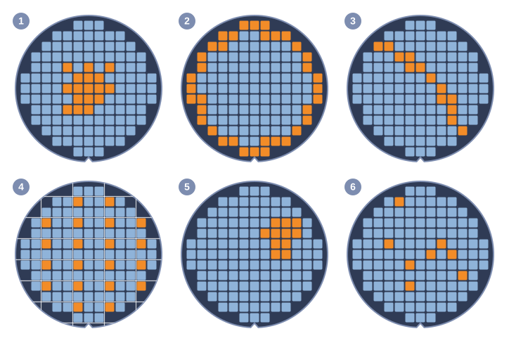

<!-- source: zh-TW/4-yield-and-quality/17-yield-analysis/README.md | sha: a63d0650a5db -->

# 第 17 章　歩留まりと故障解析：チップが壊れた原因を突き止める

> 📍 **ウェーハの現在地**
>
> - 前の工程：ウェーハがプロセスを終え、電気テストを通った
> - **この章：歩留まりを解析し、チップが壊れた原因を突き止める**
> - 次の工程：見つけた原因をプロセスにフィードバックし、改善を続ける

---

## 歩留まりはお金そのもの

ウェーハ 1 枚の製造コストはおおむね決まっています。その上の良品チップが多いほど、チップ 1 個あたりのコストは下がります。つまり歩留まりは、チップのコストと工場の利益を直接決めるのです。

新しいプロセスが量産を始めたばかりのころは、歩留まりはふつう高くありません。エンジニアが問題を一つずつ見つけて解決していくと、歩留まりは少しずつ上がっていきます。この過程を **歩留まりの学習曲線** と呼びます。この曲線を速く登れる者ほど、競争力が高いのです。

---

## 歩留まりの計算

歩留まりはふつう、いくつかの段階に分けて見ます。

- **ライン歩留まり**：投入したウェーハのうち、途中で廃棄されずに前工程を終えた枚数の割合。
- **ダイ歩留まり**：ウェーハ 1 枚の上で、ウェーハテストに合格したダイの割合。
- **最終テスト歩留まり**：パッケージ後のチップのうち、最終テストに合格した割合。

全体の歩留まりは、これらの段階の掛け算です。たとえば 98% × 90% × 99% なら、全体の歩留まりは約 87% にしかなりません。

> [!NOTE]
> **📖 用語｜歩留まり（良率）**
>
> - **定義**：作ったもののうち、良品が占める割合。
> - **現場での使い方**：「このロットの CP 歩留まりが 8 割まで落ちた」。
> - **関連用語**：ライン歩留まり、ダイ歩留まり、最終テスト歩留まり、歩留まりの学習曲線
> - **よくある混同**：「歩留まり」と聞いたら、まずどの歩留まりかを確認する。ライン歩留まり 98% とダイ歩留まり 98% は、意味がまったく違う。

---

## 欠陥とダイの大きさ

欠陥を、ウェーハにランダムに落ちてくる雨粒だと考えてみてください。ダイが大きいほど、雨粒に当たる確率は高くなります。そのため欠陥密度が同じなら、大きなダイの歩留まりは小さなダイよりずっと低くなります。これは、近年大きなチップを複数の小さなチップに分ける理由の一つでもあります。[第 22 章](../../5-backend/22-advanced-packaging/README.md)を参照してください。

<!-- Figure: 同じ欠陥分布での、大きなダイと小さなダイの歩留まりの違い -->

歩留まりの損失は、大きく 2 種類に分けられます。

- **ランダム**：たとえばパーティクルがウェーハにランダムに落ちるもの。全体の清浄度を上げて少しずつ減らすしかない。
- **システマティック**：決まった原因があるもの。特定のパターンが問題を起こしやすい、ある装置が異常、ウェーハ端の制御が悪い、などである。原因が見つかれば、一度に解決できることが多い。

---

## ウェーハマップから手がかりを読む

ウェーハテストのあと、各ダイの良否は **ウェーハマップ** として描かれます。不良ダイの分布の形は、原因を探る最初の手がかりになることがよくあります。

| パターンの特徴 | 考えられる方向性 |
|---|---|
| ウェーハ中心に集中 | 成膜、エッチング、研磨での中心と周辺の差 |
| リング状、または端に集中 | ウェーハ端のプロセス制御の問題 |
| 直線や弧 | スクラッチ |
| 各ショットの同じ位置 | マスクの欠陥や露光の問題 |
| 塊になっている | 局所的な汚染や局所的な異常 |
| ランダムに散らばる | パーティクルなどのランダム欠陥 |

*図：よくあるウェーハマップのパターン。青は良品ダイ、オレンジは不良ダイ。① 中心に集中 ② 端にリング状に集中 ③ 弧状のスクラッチ ④ 各ショットの同じ位置（白線はショットの境界） ⑤ 塊 ⑥ ランダムに散らばる。*

> [!NOTE]
> **📖 用語｜ウェーハマップ（晶圓圖）**
>
> - **定義**：ウェーハ上の各ダイのテスト結果を、位置どおりに描いた分布図。
> - **現場での使い方**：「このウェーハのマップにスクラッチが 1 本ある」。
> - **関連用語**：ビン、ウェーハテスト、欠陥マップ
> - **よくある混同**：ウェーハマップは電気テストの結果で、欠陥マップは欠陥検査の結果である。2 枚を重ねて比べれば、どの欠陥が本当にチップを不良にしたのかがわかる。

> [!TIP]
> **🔧 ノウハウ｜どのショットも同じ位置で壊れていたら、まずマスクを疑う**
>
> - **状況**：ウェーハマップ上の不良ダイが、どのショットでも同じ位置に現れている。
> - **やり方**：まずその層で使ったマスクと、関連する露光条件を調べる。
> - **理由**：露光装置は毎回同じマスクで露光するので、マスク上の欠陥はすべてのショットに「コピー」される。
> - **やらないとどうなる**：ふつうのランダム欠陥として扱うと、間違った方向に多くの時間を費やし、問題のマスクはその後のウェーハにも影響し続ける。
> - **関連する章**：[第 5 章 リソグラフィ](../../2-process-modules/05-lithography/README.md)

---

## 共通性解析

いくつかのロットで歩留まりが特に悪いとき、最も効果的な第一歩は、それらのウェーハの **共通点** を見つけることです。すべて同じ装置、同じチャンバーを通ったのか。同じ時期に生産されたのか。同じロットの薬品を使ったのか。

この解析を **共通性解析** と呼びます。これを支えているのは、工場のシステムが記録した各ウェーハの完全な履歴です。[第 24 章](../../6-beyond-the-fab/24-fab-systems/README.md)を参照してください。

> [!TIP]
> **🔧 ノウハウ｜原因を探す前に、まず共通点を探す**
>
> - **状況**：複数のロットで歩留まりが異常だが、原因がわからない。
> - **やり方**：歩留まりの悪いウェーハと正常なウェーハを、通った装置、チャンバー、時間、材料ごとに比べ、悪いウェーハにだけある共通点を見つける。
> - **理由**：ウェーハは数百の工程を通るので、すべての工程を詳しく調べることはできない。共通性解析なら、範囲を素早く数工程まで絞り込める。
> - **やらないとどうなる**：調査があてもなくさまよい、問題がさらに多くのウェーハに影響し続ける。
> - **関連する章**：[第 7 章 エッチング](../../2-process-modules/07-etching/README.md)

---

## 故障解析：「犯人」を見つける

統計的な解析で言えるのは「どこが怪しいか」までです。最後は **故障解析**（FA、Failure Analysis）で、実際の証拠を見つける必要があります。

1. **電気的な故障箇所の特定**：電気テストと特殊な画像技術で、チップ上の故障箇所を探す。故障点はかすかな光や熱を出すことが多い。
2. **層ごとの除去**：チップの上の材料を 1 層ずつ取り除き、層ごとに観察する。
3. **精密な断面加工**：**集束イオンビーム**（FIB）で、故障箇所の断面を正確に切り出す。
4. **観察と分析**：電子顕微鏡で構造を観察し、必要なら材料の成分も分析して、ショート、断線、ボイド、汚染のどれかを確かめる。

---

## この章のポイント

1. 歩留まりはチップのコストを直接決め、新しいプロセスは歩留まりが少しずつ上がる学習曲線をたどる。
2. 歩留まりはライン、ダイ、最終テストなどの段階に分かれ、全体の歩留まりはそれらの掛け算である。
3. ダイが大きいほど欠陥に当たりやすく、歩留まりは低くなる。
4. ウェーハマップの形は原因を探る最初の手がかりで、共通性解析で範囲を素早く絞り込める。
5. 故障解析は電気的な特定と物理的な解析で、故障の実際の証拠を見つける。

---

## 参考文献

- Gary S. May、Costas J. Spanos『Fundamentals of Semiconductor Manufacturing and Process Control』歩留まりに関する章
- EDFAS／ASM International『Microelectronics Failure Analysis Desk Reference』

---

[← 第 16 章　計測と検査](../../4-yield-and-quality/16-metrology/README.md) ｜ [目次](../../README.md) ｜ [第 18 章　プロセス制御 →](../../4-yield-and-quality/18-process-control/README.md)
