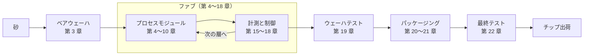

<!-- source: zh-TW/README.md | sha: fa04466ddffc -->

# 半導体製造入門

**1 枚のウェーハを追いかけて、砂からチップまでの旅をたどる**

🌐 [简体中文](../zh-CN/README.md) ｜ [繁體中文](../zh-TW/README.md) ｜ [English](../en/README.md) ｜ **日本語** ｜ [한국어](../ko/README.md) ｜ [ホーム](../README.md)

---

## この本について

爪ほどの大きさのチップには、数十億個のトランジスタが載っています。それらはすべて、薄いシリコンウェーハの上で、数百から千を超える工程を数か月かけて「作られた」ものです。

この本は **1 枚のウェーハ** を追いかけます。砂から出発し、ファブ（半導体工場）の中を一つずつ進み、リソグラフィ、薄膜、エッチング、イオン注入、研磨、配線形成を経て、テストとパッケージングへ。最後にスマートフォンやパソコンに入るチップになるまでをたどります。

難しい物理や数式は扱わず、次の 3 つに集中します。

- **プロセスの流れ**：各工程が何をしているのか、なぜそうするのか、なぜその順番なのか。
- **用語**：英語と中国語の名称、そしてファブの中で実際にどう使われているか。
- **ノウハウ**：教科書にはあまり書かれていないが、現場では必ず出会うこと。

## こんな人におすすめ

- チップがどう作られるのかを知りたい理工系の読者。たとえばソフトウェア、ファームウェア、電気系のエンジニアや学生。
- 半導体業界に入る準備をしていて、製造の流れと現場の言葉を先に知っておきたい新人。
- すでに業界で働いていて、自分の担当範囲には詳しいが、全体像を見てみたい人。

半導体物理や化学の予備知識は必要ありません。高校程度の理科の知識で十分です。

## 各章にある 3 つの道しるべ

| マーク | 内容 |
|---|---|
| 📍 ウェーハの現在地 | ウェーハが旅のどの地点にいるか、前後の工程は何か |
| 📖 用語ボックス | 定義、現場での使い方、関連用語、よくある混同 |
| 🔧 ノウハウボックス | 現場でのやり方と、なぜそうするのか、やらないとどうなるか |

たとえば第 4 章「リソグラフィ」のノウハウボックスはこうなっています。

> [!TIP]
> **🔧 ノウハウ｜リソグラフィは「やり直せる」最後のチャンス**
>
> - **状況**：検査で、パターンの寸法や重ね合わせが規格から外れていることがわかった。
> - **やり方**：フォトレジストをすべて剥がし、もう一度塗布して露光する。これを **リワーク** と呼ぶ。
> - **理由**：この時点では、ウェーハにはレジストが 1 層のっただけで、下の材料にはまだ手をつけていない。
> - **やらないとどうなる**：エッチングに進むと、間違ったパターンが材料に永久に刻まれ、ウェーハは廃棄するしかなくなるかもしれない。

---

## 全体マップ

ファブの中で、ウェーハは「材料を成膜する、リソグラフィでパターンを作る、エッチングまたはイオン注入、洗浄、計測」というループを何度も繰り返し、1 層ずつ積み上げられていきます。第 11～14 章ではこれらのモジュールを一つの流れにつなげ、第 23 章と第 24 章では、工場のシステムとファームウェアの視点から旅全体をもう一度見直します。

---

## 目次

### 第 0 部　はじめる前に

| 章 | 内容 |
|---|---|
| [第 0 章　半導体製造の全体像](0-before-you-start/00-overview/README.md) | チップが設計から出荷までたどる旅と、業界の分業 |
| [第 1 章　ファブの仕組み](0-before-you-start/01-how-a-fab-works/README.md) | クリーンルーム、自動搬送、装置、ユーティリティ、ファブで働く人々 |

### 第 1 部　基礎

| 章 | 内容 |
|---|---|
| [第 2 章　物理からトランジスタへ](1-fundamentals/02-transistor-basics/README.md) | 半導体、ドーピング、MOSFET、CMOS を製造に必要な範囲で |
| [第 3 章　砂からウェーハへ](1-fundamentals/03-sand-to-wafer/README.md) | 精製、結晶成長、スライス、研磨で完璧なベアウェーハを作る |

### 第 2 部　プロセスモジュール

| 章 | 内容 |
|---|---|
| [第 4 章　リソグラフィ](2-process-modules/04-lithography/README.md) | マスク、レジスト、露光装置で回路をウェーハに「印刷」する |
| [第 5 章　薄膜](2-process-modules/05-thin-films/README.md) | 熱酸化、CVD、PVD、ALD、エピタキシー |
| [第 6 章　エッチング](2-process-modules/06-etching/README.md) | ドライとウェット、プラズマ、選択比、終点検出 |
| [第 7 章　イオン注入と熱処理](2-process-modules/07-ion-implantation/README.md) | ドーズ、エネルギー、アニール、熱履歴 |
| [第 8 章　CMP](2-process-modules/08-cmp/README.md) | ウェーハを平らに磨く：スラリー、ディッシング、エロージョン、ダミーパターン |
| [第 9 章　洗浄と汚染管理](2-process-modules/09-cleaning/README.md) | RCA 洗浄、Q タイム、クロスコンタミネーション |
| [第 10 章　メタライゼーション](2-process-modules/10-metallization/README.md) | コンタクト、銅ダマシン、Low-k 材料 |

### 第 3 部　プロセスインテグレーション

| 章 | 内容 |
|---|---|
| [第 11 章　CMOS プロセスフローを一通り](3-integration/11-cmos-process-flow/README.md) | FEOL、MOL、BEOL とマスク枚数 |
| [第 12 章　先端トランジスタ構造](3-integration/12-advanced-transistors/README.md) | FinFET、GAA、裏面電源供給 |
| [第 13 章　メモリのプロセス](3-integration/13-memory/README.md) | DRAM、3D NAND、HBM |
| [第 14 章　「何ナノ」とは何か](3-integration/14-process-nodes/README.md) | プロセスノード、ピッチ、トランジスタ密度 |

### 第 4 部　品質と歩留まり

| 章 | 内容 |
|---|---|
| [第 15 章　計測と検査](4-yield-and-quality/15-metrology/README.md) | 膜厚、CD、重ね合わせ、欠陥検査、サンプリング |
| [第 16 章　歩留まりと故障解析](4-yield-and-quality/16-yield-analysis/README.md) | ウェーハマップの読み方、共通性解析、故障解析 |
| [第 17 章　プロセス制御](4-yield-and-quality/17-process-control/README.md) | SPC、Cpk、R2R、FDC |
| [第 18 章　異常処置と変更管理](4-yield-and-quality/18-abnormality-handling/README.md) | OCAP、ホールド、MRB、変更管理 |

### 第 5 部　後工程：テストとパッケージング

| 章 | 内容 |
|---|---|
| [第 19 章　ウェーハテスト](5-backend/19-wafer-test/README.md) | WAT と CP で良品ダイを見つける |
| [第 20 章　パッケージング](5-backend/20-packaging/README.md) | ダイシング、ワイヤボンディング、フリップチップ、主なパッケージ |
| [第 21 章　先端パッケージング](5-backend/21-advanced-packaging/README.md) | 2.5D、3D 積層、ハイブリッドボンディング、チップレット |
| [第 22 章　最終テストと信頼性](5-backend/22-final-test-and-reliability/README.md) | バーンイン、バスタブ曲線、信頼性試験、故障メカニズム |

### 第 6 部　ファブの外へ

| 章 | 内容 |
|---|---|
| [第 23 章　システムによるファブ運営](6-beyond-the-fab/23-fab-systems/README.md) | MES、装置自動化、インターロック、ウェーハの履歴 |
| [第 24 章　プロセスとファームウェア](6-beyond-the-fab/24-process-and-firmware/README.md) | DRAM リフレッシュ、Row Hammer、ECC、NAND、チップの改版 |

### 付録

| 付録 | 内容 |
|---|---|
| [付録 A　用語集](appendix/glossary.md) | 200 を超える用語の日本語・英語・中国語対照と略語 |
| [付録 B　現場用語](appendix/fab-jargon.md) | ファブでよく聞く言い回しと例文 |
| [付録 C　参考文献](appendix/further-reading.md) | 教科書、業界標準、学会 |

---

## 読み方のおすすめ

最初から順に読むのがいちばん全体をつかめますが、目的に合わせて次のルートから始めることもできます。

| ルート | おすすめの章 |
|---|---|
| 🚀 全体をざっと知りたい | 第 0、1、11、14 章 |
| 💻 ソフトウェア・ファームウェアエンジニア | 第 0、2、11、13、14、22、23、24 章 |
| 🏭 半導体業界に入る準備 | 全章を順に。特に第 1、11、15～18 章と付録 B |
| 📦 パッケージングとテストに関心がある | 第 0、11、19～22 章 |

---

## 参加するには

これはオープンなプロジェクトです。いつでも協力を歓迎します。

- **間違いを見つけたら**：[Issues](../../../issues) から「Erratum」テンプレートで報告してください。
- **内容や図を追加したいとき**：[コントリビューションガイド](../CONTRIBUTING.md) と [スタイルガイド](../STYLE_GUIDE.md) を読んでください。
- **ほかの言語に翻訳したいとき**：[翻訳ガイド](../TRANSLATIONS.md) を読んでください。

この本が役に立ったら、⭐ Star を付けてもらえると、より多くの人に届きます。

---

## 免責事項

- この本は公開情報と業界の一般的な知識をもとにしています。特定企業の機密情報、プロセス条件、社内手順は含みません。
- 特定の半導体企業とは関係がなく、業界で一般的な技術用語だけを使っています。
- 数値の多くは桁や概算値です。実際の値はプロセス、製品、企業によって異なります。
- 間違いや古くなった内容を見つけたら、Issue で知らせてください。

## ライセンス

この本の文章と図は [クリエイティブ・コモンズ 表示 - 非営利 - 継承 4.0 国際ライセンス](../LICENSE)（CC BY-NC-SA 4.0）で提供しています。出典を明記し、非営利目的で、同じライセンスで共有する限り、自由に転載、改変、翻訳できます。

原文は繁体字中国語で書かれており、日本語版はその翻訳です。内容に違いがある場合は、中国語版を正とします。
