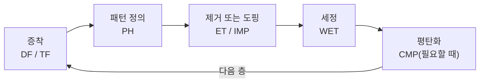

<!-- source: zh-TW/2-process-modules/04-fab-modules/README.md | sha: 3c48565cbac0 -->

# 제4장 팹의 7개 모듈: 어느 부서가 어떤 공정을 맡는가

> 📍 **웨이퍼의 현재 위치**
>
> - 이전 단계: 모래에서 웨이퍼까지. 빈 웨이퍼가 팹에 들어갈 준비를 마쳤다
> - **이 장: 공정을 나눠 맡는 7개 모듈을 알아본다**
> - 다음 단계: 리소그래피. 웨이퍼가 첫 번째 모듈에 들어간다

---

## 왜 모듈을 먼저 알아야 하는가

교과서는 보통 '기술'로 장을 나눕니다. 산화, CVD, 어닐링, 식각 같은 식입니다. 반면 팹은 '부서'로 일을 나눕니다. 현장에서는 이 부서를 **모듈**이라고 부릅니다.

병원과 조금 비슷합니다. 의학 교과서는 장기와 질병별로 장을 나누지만, 병원은 내과, 외과, 영상의학과로 나뉩니다. 한 환자가 여러 과를 오가고, 각 과는 자기가 맡은 부분만 처리합니다.

웨이퍼도 마찬가지입니다. 팹 안에서 수백 개의 단계를 거치고, 모든 단계는 어느 한 모듈에 속합니다. 모듈의 분담을 이해하면 웨이퍼의 생산 흐름을 읽을 수 있고, 문제가 생겼을 때 누구를 찾아야 하는지도 알 수 있습니다.

> [!NOTE]
> **📖 용어｜모듈（製程模組）**
>
> - **정의**: 팹 안에서 한 종류의 공정을 맡는 부서. 장비, 공정 엔지니어, 장비 엔지니어를 포함한다.
> - **현장에서는**: 약칭으로 부르는 경우가 많다. "이 단계는 DF 담당이다." "이 문제는 ET에 물어봐."
> - **관련 용어**: 루트, 단계(스텝), 레시피, 장비군
> - **흔한 혼동**: 모듈은 '부서'이지 '기술'이 아니다. 같은 기술이 다른 모듈에 속할 수도 있다. 예를 들어 산화막은 DF에서 성장시킬 수도, TF에서 증착할 수도 있다.

---

## 7개 모듈 한눈에 보기

| 약칭 | 현장에서 부르는 이름 | 주요 업무 | 장비 형태 | 이 책의 장 |
|---|---|---|---|---|
| PH(Photo) | 포토, 황광(黃光) | 감광액 도포, 노광, 현상으로 패턴을 정의한다 | 매엽식 | [제5장](../../2-process-modules/05-lithography/README.md) |
| DF(Diffusion) | 퍼니스 | 고온 산화, 저압 CVD, 어닐링 | 배치식 | [제6장](../../2-process-modules/06-thin-films/README.md), [제8장](../../2-process-modules/08-ion-implantation/README.md) |
| TF(Thin Film) | 박막 | PECVD, PVD 스퍼터링, 금속 CVD, ALD | 주로 매엽식 | [제6장](../../2-process-modules/06-thin-films/README.md), [제11장](../../2-process-modules/11-metallization/README.md) |
| ET(Etch) | 식각 | 건식 식각, 감광액 제거 | 매엽식 | [제7장](../../2-process-modules/07-etching/README.md) |
| IMP(Implant) | 임플란트 | 불순물을 실리콘에 쏘아 넣는다 | 주로 매엽식 | [제8장](../../2-process-modules/08-ion-implantation/README.md) |
| CMP | CMP, 연마 | 웨이퍼 표면을 평평하게 깎는다 | 매엽식 | [제9장](../../2-process-modules/09-cmp/README.md) |
| WET | 웨트, 세정 | 세정, 습식 식각, 감광액 제거 | 배치식과 매엽식 | [제10장](../../2-process-modules/10-cleaning/README.md) |

나누는 방식은 회사마다 조금씩 다릅니다. 흔한 차이는 IMP와 DF가 한 부서로 합쳐져 있거나, WET이 DF나 ET에 포함되어 있는 경우입니다. 계측 단계는 각 모듈이 직접 맡는 팹도 있고, 별도 부서를 두는 팹도 있습니다.

---

## 각 모듈이 하는 일

**PH(포토)**: 웨이퍼는 도포·현상 장비와 노광 장비 사이를 자동으로 오갑니다. 끝나면 선폭과 정렬을 검사합니다(ADI). 불합격이면 감광액을 벗겨 내고 다시 할 수 있습니다. PH는 '다시 할 수 있는' 유일한 모듈입니다.

**DF(퍼니스)**: 100장이 넘는 웨이퍼를 세로형 석영 튜브에 넣고 몇 시간 동안 가열합니다. 주요 공정은 다음과 같습니다.

- **산화**: 패드 산화막이나 두꺼운 산화막을 성장시킵니다.
- **저압 CVD**: 낮은 압력과 높은 온도에서 질화실리콘, 폴리실리콘, 산화막을 증착합니다.
- **어닐링**: 이온 주입 후 결정을 회복시키거나, 증착한 산화막을 치밀하게 만듭니다.
- **Alloy**: 후공정이 끝나기 전에 수소가 들어 있는 가스 속에서 저온으로 가열해 계면 결함을 회복시킵니다.

**TF(박막)**: 대부분 한 번에 한 장씩 처리하는 챔버형 장비입니다. 플라즈마로 반응을 돕는 PECVD는 온도가 낮아 금속층 이후에도 쓸 수 있습니다. PVD는 스퍼터링으로 금속을 증착합니다. 텅스텐과 ALD도 여기서 하는 경우가 많습니다. 구리 도금을 TF에 넣는 회사도 있습니다.

**ET(식각)**: 플라즈마로 감광액 패턴을 따라 재료를 제거합니다. 트렌치와 게이트부터 콘택과 금속 배선까지 다룹니다. 식각이 끝나면 산소 플라즈마로 감광액을 태워 없애고, 선폭과 결함을 검사합니다(AEI).

**IMP(임플란트)**: 도즈와 깊이에 따라 종류가 다른 이온 주입 장비를 씁니다. 주입 전에는 보통 PH에서 감광액 패턴을 만들어, 맞으면 안 되는 영역을 가립니다.

**CMP(연마)**: 울퉁불퉁한 표면을 평평하게 깎습니다. 자주 다루는 것은 산화막, 텅스텐, 구리입니다. 연마 장비 안에 세정이 들어 있어서, 웨이퍼는 마른 상태로 들어가 마른 상태로 나옵니다.

**WET(웨트)**: 약액으로 세정하거나 식각합니다. 예를 들어 퍼니스에 들어가기 전의 RCA 세정, HF로 산화막 제거, 뜨거운 인산으로 질화실리콘 제거가 있습니다.

> [!NOTE]
> **📖 용어｜퍼니스（Furnace, 현장에서는 Diffusion, DF라고도 부른다）**
>
> - **정의**: 100장이 넘는 웨이퍼를 한 번에 처리하는 세로형 고온 배치식 장비. 산화, 저압 CVD, 어닐링을 맡는다.
> - **현장에서는**: "이 로트는 DF 배치가 찰 때까지 기다리는 중이다." "이 퍼니스는 다 돌고 나면 식을 때까지 기다려야 한다."
> - **관련 용어**: 저압 CVD, 어닐링, 더미 웨이퍼, 배치 구성
> - **흔한 혼동**: '확산(Diffusion)'은 역사적인 이름이다. 예전에는 고온으로 불순물을 실리콘에 확산시켰다. 지금은 도핑 대부분을 IMP가 맡고, 퍼니스에서 확산으로 도핑하는 일은 거의 없다.

---

## 같은 기술이 다른 모듈에 속하기도 한다

초보자가 가장 헷갈리는 것은 같은 이름이 여러 모듈에 나온다는 점입니다.

| 기술 | 하는 곳 | 차이 |
|---|---|---|
| 산화막 | DF 열산화, DF 저압 CVD, TF PECVD | 온도, 막질, 금속 이후에 쓸 수 있는지 |
| 어닐링 | DF 퍼니스, RTA 장비 | 퍼니스는 시간이 길고, RTA는 몇 초면 끝나 열 예산이 작다 |
| 식각 | ET 건식 식각, WET 습식 식각 | 건식은 수직의 미세한 패턴을 만들 수 있고, 습식은 빠르지만 옆으로도 깎인다 |
| 감광액 제거 | ET 애싱, WET 약액 제거 | 둘 다 하는 경우가 많다. 먼저 애싱하고, 다음에 습식으로 깨끗이 정리한다 |

그래서 단계를 볼 때는 어느 모듈에 속하는지와 어떤 기술을 쓰는지를 함께 봐야 합니다.

---

## 이어서 보기: 루트의 한 구간

트랜지스터끼리 분리하는 STI(얕은 트렌치 소자 분리)를 예로 들면, 웨이퍼는 다음과 같이 모듈 사이를 오갑니다.

**DF → DF → PH → ET → WET → TF → DF → CMP → WET**

1. **DF**: 얇은 패드 산화막을 성장시켜 다음 층의 응력을 완화합니다.
2. **DF**: 저압 CVD로 질화실리콘을 증착해 하드 마스크와 연마 정지층으로 씁니다.
3. **PH**: 트렌치의 위치를 정의합니다.
4. **ET**: 트렌치를 파고 감광액을 태워 없앱니다.
5. **WET**: 트렌치 표면을 세정합니다.
6. **TF**: CVD로 트렌치에 산화막을 채웁니다.
7. **DF**: 어닐링으로 채운 산화막을 치밀하게 만듭니다.
8. **CMP**: 남는 산화막을 깎아 내고 질화실리콘에서 멈춥니다.
9. **WET**: 뜨거운 인산으로 질화실리콘을 제거합니다.

팹 전체의 흐름은 거의 이 루프를 수십 번 반복한 것입니다. [제12장](../../3-integration/12-cmos-process-flow/README.md)에서는 CMOS 흐름 전체를 따라갑니다.

> [!TIP]
> **🔧 노하우｜문제를 발견한 모듈이 문제를 만든 모듈이라고는 할 수 없다**
>
> - **상황**: PH의 ADI에서 선폭 변동이 발견되었다. 또는 CMP 후에 막 두께가 고르지 않은 것이 발견되었다.
> - **방법**: 문제를 발견한 단계만 볼 것이 아니라 몇 단계 앞의 이력까지 거슬러 올라가 확인한다. 예를 들어 앞 막의 두께, 퍼니스 안의 위치, 세정 후 얼마나 기다렸는지를 본다.
> - **이유**: 모든 모듈은 앞 단계의 결과를 이어받는다. 막 두께가 바뀌면 노광할 때의 반사가 바뀌고, 트렌치 깊이가 다르면 연마 후의 높이가 바뀐다.
> - **안 하면 어떻게 되나**: 문제를 발견한 단계만 조정하면 상류의 문제를 덮어 버리는 셈이 된다. 진짜 원인은 그대로 남아 다음 로트에서도 같은 문제가 생긴다.
> - **관련 장**: [제17장 수율과 불량 분석](../../4-yield-and-quality/17-yield-analysis/README.md), [제19장 이상 처리와 엔지니어링 변경](../../4-yield-and-quality/19-abnormality-handling/README.md)

> [!TIP]
> **🔧 노하우｜모듈 사이의 인계가 사고가 가장 잘 나는 곳이다**
>
> - **상황**: WET에서 세정을 마친 웨이퍼가 DF에서 퍼니스 한 번 분량이 찰 때까지 기다렸다가 퍼니스에 들어간다.
> - **방법**: 두 모듈이 함께 Q-Time을 정하고 디스패칭을 조율해, 세정 시점을 퍼니스 배치 구성에 맞춘다.
> - **이유**: 각 모듈은 자기 장비만 보인다. 세정을 너무 일찍 하면 웨이퍼가 중간에서 너무 오래 기다리게 된다.
> - **안 하면 어떻게 되나**: Q-Time을 넘기면 표면에 산화막이 다시 자라거나 오염이 묻어, 웨이퍼를 다시 세정해야 한다. 전기적 특성에 영향을 줄 수도 있다.
> - **관련 장**: [제10장 세정과 오염 관리](../../2-process-modules/10-cleaning/README.md), [제24장 시스템이 팹을 운영하는 방법](../../6-beyond-the-fab/24-fab-systems/README.md)

---

## 이 장의 핵심

1. 교과서는 기술로 장을 나누고, 팹은 모듈로 일을 나눈다.
2. 주요 7개 모듈은 PH, DF, TF, ET, IMP, CMP, WET이며, 나누는 방식은 회사마다 조금씩 다르다.
3. 퍼니스(DF)는 고온 배치식 장비로, 산화, 저압 CVD, 어닐링을 맡는다.
4. 산화막, 어닐링, 식각, 감광액 제거처럼 같은 기술이 다른 모듈에 속하기도 한다.
5. 웨이퍼는 '증착, 패턴 정의, 제거 또는 도핑, 세정, 평탄화'의 루프를 반복해서 거친다.

---

## 참고 자료

- Hong Xiao, 『Introduction to Semiconductor Manufacturing Technology』, 공정 모듈별로 구성된 장
- Michael Quirk, Julian Serda, 『Semiconductor Manufacturing Technology』
- Peter Van Zant, 『Microchip Fabrication』

---

[← 제3장 모래에서 웨이퍼까지](../../1-fundamentals/03-sand-to-wafer/README.md) ｜ [목차](../../README.md) ｜ [제5장 리소그래피 →](../../2-process-modules/05-lithography/README.md)
