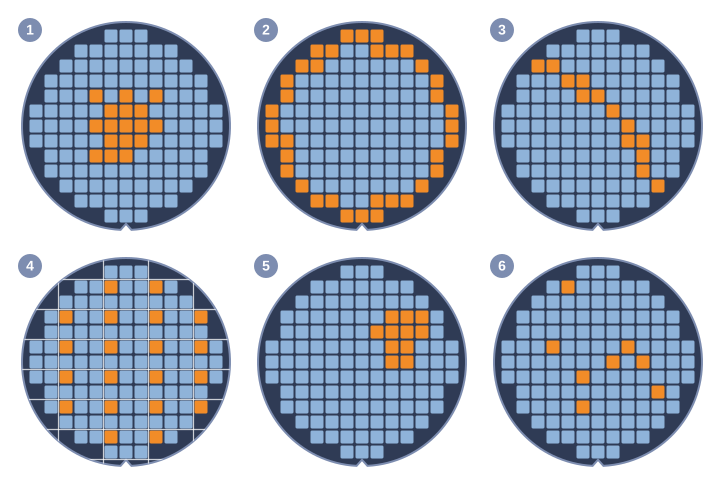

<!-- source: zh-TW/4-yield-and-quality/17-yield-analysis/README.md | sha: a63d0650a5db -->

# 제17장 수율과 불량 분석: 칩이 왜 불량인지 찾아내기

> 📍 **웨이퍼의 현재 위치**
>
> - 이전 단계: 웨이퍼가 공정을 마치고 전기적 테스트를 거쳤다
> - **이 장: 수율을 분석하고 칩이 왜 불량인지 찾아낸다**
> - 다음 단계: 원인을 공정에 되돌려 지속적으로 개선한다

---

## 수율은 곧 돈이다

웨이퍼 한 장을 만드는 비용은 대체로 정해져 있습니다. 그 위에 양품 칩이 많을수록 칩 하나당 비용이 내려갑니다. 그래서 수율은 칩 원가와 팹의 이익을 직접 좌우합니다.

새 공정이 처음 양산에 들어가면 수율은 보통 낮습니다. 엔지니어들이 문제를 하나씩 찾아 해결하면서 수율이 차츰 올라갑니다. 이 과정을 **수율 학습 곡선**이라고 합니다. 이 곡선을 더 빨리 올라가는 쪽이 경쟁력을 갖습니다.

---

## 수율은 어떻게 계산하나

수율은 보통 몇 단계로 나눠 봅니다.

- **라인 수율**: 투입한 웨이퍼 가운데 중간에 폐기되지 않고 전공정을 마친 비율.
- **다이 수율**: 웨이퍼 한 장에서 웨이퍼 테스트를 통과한 다이의 비율.
- **최종 테스트 수율**: 패키징된 칩 가운데 최종 테스트를 통과한 비율.

전체 수율은 이 단계들의 곱입니다. 예를 들어 98% × 90% × 99%이면 전체 수율은 약 87%밖에 남지 않습니다.

> [!NOTE]
> **📖 용어｜수율（良率）**
>
> - **정의**: 만든 제품 전체 가운데 양품의 비율.
> - **현장에서는**: "이 로트 CP 수율이 80%까지 떨어졌어."
> - **관련 용어**: 라인 수율, 다이 수율, 최종 테스트 수율, 수율 학습 곡선
> - **흔한 혼동**: '수율'이라는 말을 들으면 먼저 어느 수율인지 물어야 한다. 라인 수율 98%와 다이 수율 98%는 전혀 다른 뜻이다.

---

## 결함과 다이 크기

결함을 웨이퍼 위에 무작위로 떨어지는 빗방울이라고 생각해 보세요. 다이가 클수록 빗방울을 맞기 쉽습니다. 그래서 결함 밀도가 같다면 큰 다이는 작은 다이보다 수율이 훨씬 낮습니다. 최근 업계가 큰 칩을 여러 개의 작은 칩으로 나누는 이유 중 하나입니다. [제22장](../../5-backend/22-advanced-packaging/README.md)을 참고하세요.

<!-- Figure: 같은 결함 분포에서 큰 다이와 작은 다이의 수율 차이 -->

수율 손실은 크게 두 종류로 나뉩니다.

- **랜덤성**: 예를 들어 웨이퍼에 무작위로 떨어지는 입자. 전체 청정도를 높여 서서히 줄일 수밖에 없다.
- **체계성**: 특히 문제가 생기기 쉬운 패턴, 이상이 있는 장비, 웨이퍼 가장자리의 제어 부족처럼 원인이 정해져 있다. 원인을 찾으면 한 번에 해결되는 경우가 많다.

---

## 웨이퍼 맵의 단서

웨이퍼 테스트가 끝나면 다이마다 합격·불합격 결과를 **웨이퍼 맵**으로 그립니다. 불량 다이가 분포한 모양이 원인을 찾는 첫 번째 단서가 되는 경우가 많습니다.

| 패턴 | 짐작되는 방향 |
|---|---|
| 웨이퍼 중앙에 몰림 | 증착, 식각, 연마의 중앙·가장자리 차이 |
| 고리 모양 또는 가장자리에 몰림 | 웨이퍼 가장자리의 공정 제어 문제 |
| 직선이나 호 모양 | 스크래치 |
| 모든 노광 필드의 같은 위치 | 마스크 결함 또는 노광 문제 |
| 덩어리 모양 | 국부적 오염 또는 국부적 이상 |
| 무작위로 흩어짐 | 입자 같은 랜덤 결함 |

*그림: 웨이퍼 맵의 흔한 패턴. 파란 다이는 양품, 주황 다이는 불량이다. ① 중앙에 몰림 ② 가장자리의 고리 ③ 호 모양 스크래치 ④ 모든 노광 필드의 같은 위치(흰 선은 필드 경계) ⑤ 덩어리 ⑥ 무작위로 흩어짐.*

> [!NOTE]
> **📖 용어｜웨이퍼 맵（晶圓圖）**
>
> - **정의**: 웨이퍼 위 다이 하나하나의 테스트 결과를 그 위치에 표시한 지도.
> - **현장에서는**: "이 웨이퍼 맵에 스크래치가 있다."
> - **관련 용어**: 빈, 웨이퍼 테스트, 결함 맵
> - **흔한 혼동**: 웨이퍼 맵은 전기적 테스트 결과를, 결함 맵은 결함 검사 결과를 보여 준다. 둘을 겹쳐 보면 어떤 결함이 실제로 칩 불량을 일으켰는지 알 수 있다.

> [!TIP]
> **🔧 노하우｜모든 노광 필드의 같은 위치가 불량이면 먼저 마스크를 의심한다**
>
> - **상황**: 웨이퍼 맵에서 불량 다이가 모든 노광 필드의 같은 위치에 나타난다.
> - **방법**: 먼저 그 층에 쓴 마스크와 관련 노광 조건을 확인한다.
> - **이유**: 노광 장비는 노광할 때마다 같은 마스크를 쓰므로, 마스크 위의 결함이 모든 노광 필드에 '복사'된다.
> - **안 하면 어떻게 되나**: 일반적인 랜덤 결함으로 여기면 엉뚱한 방향으로 시간을 많이 쓰게 되고, 불량 마스크가 뒤따르는 웨이퍼에 계속 영향을 준다.
> - **관련 장**: [제5장 리소그래피](../../2-process-modules/05-lithography/README.md)

---

## 공통성 분석

여러 로트의 수율이 유난히 나쁠 때, 가장 효과적인 첫 단계는 이 웨이퍼들의 **공통점**을 찾는 것입니다. 모두 같은 장비나 같은 챔버를 거쳤는가? 같은 시기에 처리되었는가? 같은 배치의 화학약품을 썼는가?

이를 **공통성 분석**이라고 하며, 공장 시스템이 기록한 웨이퍼마다의 완전한 이력에 의존합니다. [제24장](../../6-beyond-the-fab/24-fab-systems/README.md)을 참고하세요.

> [!TIP]
> **🔧 노하우｜원인을 찾기 전에 공통점부터 찾는다**
>
> - **상황**: 여러 로트의 수율이 이상한데, 아무도 이유를 모른다.
> - **방법**: 수율이 낮은 웨이퍼와 정상인 웨이퍼를 단계별로 비교해, 거친 장비, 챔버, 시간, 재료를 살펴보고, 불량 웨이퍼만 공유하는 것을 찾는다.
> - **이유**: 웨이퍼는 수백 개의 단계를 거치므로, 모든 단계를 자세히 조사할 수는 없다. 공통성 분석은 조사 범위를 몇 개의 단계로 빠르게 좁혀 준다.
> - **안 하면 어떻게 되나**: 조사가 방향 없이 헤매고, 문제는 계속 더 많은 웨이퍼에 영향을 준다.
> - **관련 장**: [제7장 식각](../../2-process-modules/07-etching/README.md)

---

## 불량 분석: 범인 찾기

통계 분석은 '어디쯤일 수 있다'까지만 알려 줍니다. 결국 물리적 증거를 찾으려면 **불량 분석**(FA)이 필요합니다.

1. **전기적 불량 위치 추적**: 전기적 테스트와 특수 영상 기법으로 칩 위의 불량 위치를 찾는다. 불량 지점은 희미한 빛이나 열을 내는 경우가 많다.
2. **디프로세싱**: 칩 위의 재료를 한 층씩 벗겨 내며 각 층을 살펴본다.
3. **정밀 단면 가공**: **집속 이온 빔**(FIB)으로 불량 위치에서 정확히 단면을 자른다.
4. **관찰과 분석**: 전자 현미경으로 구조를 보고, 필요하면 재료 조성을 분석해, 단락, 단선, 보이드, 오염 중 무엇인지 확인한다.

---

## 이 장의 핵심

1. 수율은 칩 원가를 직접 좌우하며, 새 공정은 학습 곡선을 거치며 수율이 차츰 오른다.
2. 수율은 라인, 다이, 최종 테스트 등 단계별로 나뉘며, 전체 수율은 그 곱이다.
3. 다이가 클수록 결함을 맞기 쉬워 수율이 낮아진다.
4. 웨이퍼 맵의 모양이 원인의 첫 단서이며, 공통성 분석이 조사 범위를 빠르게 좁힌다.
5. 불량 분석은 전기적 불량 위치 추적과 물리 분석으로 불량의 실제 증거를 찾는다.

---

## 참고 자료

- Gary S. May, Costas J. Spanos, 『Fundamentals of Semiconductor Manufacturing and Process Control』 수율에 관한 장
- EDFAS / ASM International, 『Microelectronics Failure Analysis Desk Reference』

---

[← 제16장 계측과 검사](../../4-yield-and-quality/16-metrology/README.md) ｜ [목차](../../README.md) ｜ [제18장 공정 제어 →](../../4-yield-and-quality/18-process-control/README.md)
