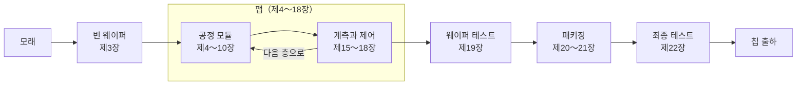

<!-- source: zh-TW/README.md | sha: fa04466ddffc -->

# 반도체 제조 입문

**웨이퍼 한 장을 따라 모래에서 칩까지의 여정을 걸어 봅니다**

🌐 [简体中文](../zh-CN/README.md) ｜ [繁體中文](../zh-TW/README.md) ｜ [English](../en/README.md) ｜ [日本語](../ja/README.md) ｜ **한국어** ｜ [홈](../README.md)

---

## 이 책은 무엇을 다루나요

손톱만 한 칩 하나에 수십억 개의 트랜지스터가 들어 있습니다. 이 트랜지스터는 모두 얇은 실리콘 웨이퍼 위에서, 수백에서 천 개가 넘는 공정을 몇 달에 걸쳐 거치며 '만들어진' 것입니다.

이 책은 **웨이퍼 한 장**을 따라갑니다. 모래에서 출발해 팹(반도체 공장) 안을 한 단계씩 지나며 리소그래피, 박막, 식각, 이온 주입, 연마, 금속 배선을 거치고, 테스트와 패키징을 지나 마침내 스마트폰과 컴퓨터에 들어가는 칩이 되기까지의 과정을 따라갑니다.

어려운 물리와 수식은 다루지 않고, 다음 세 가지에 집중합니다.

- **공정 흐름**: 각 단계가 무엇을 하는지, 왜 그렇게 하는지, 왜 그 순서인지.
- **용어**: 영어와 중국어 이름, 그리고 팹 안에서 실제로 어떻게 쓰이는지.
- **노하우**: 교과서에는 잘 나오지 않지만 현장에서는 반드시 마주치는 것들.

## 이런 분께 추천합니다

- 칩이 어떻게 만들어지는지 알고 싶은 이공계 독자. 예를 들어 소프트웨어, 펌웨어, 전기전자 엔지니어와 학생.
- 반도체 업계에 들어갈 준비를 하며, 제조 흐름과 현장 용어를 먼저 익히고 싶은 신입.
- 이미 업계에서 일하고 있지만 자기 담당 분야만 잘 알고, 전체 그림을 보고 싶은 분.

반도체 물리나 화학 배경 지식은 필요 없습니다. 고등학교 수준의 과학 지식이면 충분합니다.

## 각 장에 있는 세 가지 길잡이

| 표시 | 내용 |
|---|---|
| 📍 웨이퍼의 현재 위치 | 웨이퍼가 여정의 어느 단계에 있는지, 앞뒤 단계는 무엇인지 |
| 📖 용어 상자 | 정의, 현장에서 쓰는 법, 관련 용어, 흔한 혼동 |
| 🔧 노하우 상자 | 현장의 방법과, 왜 그렇게 하는지, 안 하면 어떻게 되는지 |

예를 들어 제4장 '리소그래피'의 노하우 상자는 이렇습니다.

> [!TIP]
> **🔧 노하우｜리소그래피는 '다시 할 수 있는' 마지막 기회**
>
> - **상황**: 검사에서 패턴 크기나 정렬이 규격을 벗어났다.
> - **방법**: 감광액을 모두 벗겨 내고 다시 도포하고 노광한다. 이를 **리워크**라고 한다.
> - **이유**: 이 시점에서는 웨이퍼 위에 감광액 한 층만 올라가 있을 뿐, 아래 재료는 아직 건드리지 않았다.
> - **안 하면 어떻게 되나**: 식각으로 넘어가면 잘못된 패턴이 재료에 영구히 새겨져, 웨이퍼를 폐기해야 할 수도 있다.

---

## 전체 지도

팹 안에서 웨이퍼는 '재료 증착, 리소그래피로 패턴 형성, 식각 또는 이온 주입, 세정, 계측'이라는 루프를 계속 반복하며 한 층씩 쌓아 올려집니다. 제11～14장에서는 이 모듈들을 하나의 흐름으로 연결하고, 제23장과 제24장에서는 공장 시스템과 펌웨어의 관점에서 여정 전체를 다시 살펴봅니다.

---

## 목차

### 제0부 시작하기 전에

| 장 | 내용 |
|---|---|
| [제0장 반도체 제조의 전체 그림](0-before-you-start/00-overview/README.md) | 칩이 설계에서 출하까지 거치는 여정과 산업의 분업 |
| [제1장 팹은 어떻게 돌아가는가](0-before-you-start/01-how-a-fab-works/README.md) | 클린룸, 자동 반송, 장비, 유틸리티, 팹에서 일하는 사람들 |

### 제1부 기초

| 장 | 내용 |
|---|---|
| [제2장 물리에서 트랜지스터까지](1-fundamentals/02-transistor-basics/README.md) | 반도체, 도핑, MOSFET, CMOS를 제조에 필요한 만큼만 |
| [제3장 모래에서 웨이퍼까지](1-fundamentals/03-sand-to-wafer/README.md) | 정제, 결정 성장, 절단, 연마로 완벽한 빈 웨이퍼 만들기 |

### 제2부 공정 모듈

| 장 | 내용 |
|---|---|
| [제4장 리소그래피](2-process-modules/04-lithography/README.md) | 마스크, 감광액, 노광 장비로 회로를 웨이퍼에 '인쇄'하기 |
| [제5장 박막](2-process-modules/05-thin-films/README.md) | 열산화, CVD, PVD, ALD, 에피택시 |
| [제6장 식각](2-process-modules/06-etching/README.md) | 건식과 습식, 플라즈마, 선택비, 종점 검출 |
| [제7장 이온 주입과 열처리](2-process-modules/07-ion-implantation/README.md) | 도즈, 에너지, 어닐링, 열 예산 |
| [제8장 CMP](2-process-modules/08-cmp/README.md) | 웨이퍼를 평평하게 연마하기: 슬러리, 디싱, 이로전, 더미 패턴 |
| [제9장 세정과 오염 관리](2-process-modules/09-cleaning/README.md) | RCA 세정, Q-타임, 교차 오염 |
| [제10장 금속 배선](2-process-modules/10-metallization/README.md) | 콘택, 구리 다마신, Low-k 소재 |

### 제3부 공정 통합

| 장 | 내용 |
|---|---|
| [제11장 CMOS 공정 흐름 한눈에 보기](3-integration/11-cmos-process-flow/README.md) | FEOL, MOL, BEOL과 마스크 수 |
| [제12장 첨단 트랜지스터 구조](3-integration/12-advanced-transistors/README.md) | FinFET, GAA, 후면 전력 공급 |
| [제13장 메모리 공정](3-integration/13-memory/README.md) | DRAM, 3D NAND, HBM |
| [제14장 '몇 나노'란 무엇인가](3-integration/14-process-nodes/README.md) | 공정 노드, 피치, 트랜지스터 밀도 |

### 제4부 품질과 수율

| 장 | 내용 |
|---|---|
| [제15장 계측과 검사](4-yield-and-quality/15-metrology/README.md) | 막 두께, CD, 오버레이, 결함 검사, 샘플링 |
| [제16장 수율과 불량 분석](4-yield-and-quality/16-yield-analysis/README.md) | 웨이퍼 맵 읽기, 공통성 분석, 불량 분석 |
| [제17장 공정 제어](4-yield-and-quality/17-process-control/README.md) | SPC, Cpk, R2R, FDC |
| [제18장 이상 처리와 엔지니어링 변경](4-yield-and-quality/18-abnormality-handling/README.md) | OCAP, 홀드, MRB, 변경 관리 |

### 제5부 후공정: 테스트와 패키징

| 장 | 내용 |
|---|---|
| [제19장 웨이퍼 테스트](5-backend/19-wafer-test/README.md) | WAT와 CP로 양품 다이 찾기 |
| [제20장 패키징](5-backend/20-packaging/README.md) | 다이싱, 와이어 본딩, 플립칩, 주요 패키지 형태 |
| [제21장 첨단 패키징](5-backend/21-advanced-packaging/README.md) | 2.5D, 3D 적층, 하이브리드 본딩, 칩렛 |
| [제22장 최종 테스트와 신뢰성](5-backend/22-final-test-and-reliability/README.md) | 번인, 욕조 곡선, 신뢰성 시험, 고장 메커니즘 |

### 제6부 팹 밖으로

| 장 | 내용 |
|---|---|
| [제23장 시스템이 팹을 운영하는 방법](6-beyond-the-fab/23-fab-systems/README.md) | MES, 장비 자동화, 인터록, 웨이퍼 이력 |
| [제24장 공정이 펌웨어에 미치는 영향](6-beyond-the-fab/24-process-and-firmware/README.md) | DRAM 리프레시, Row Hammer, ECC, NAND, 칩 리비전 |

### 부록

| 부록 | 내용 |
|---|---|
| [부록 A 용어집](appendix/glossary.md) | 200개가 넘는 용어의 한국어·영어·중국어 대조와 약어 |
| [부록 B 현장 용어](appendix/fab-jargon.md) | 팹에서 자주 듣는 표현과 예문 |
| [부록 C 참고 자료](appendix/further-reading.md) | 교과서, 산업 표준, 학회 |

---

## 읽는 방법 추천

처음부터 차례대로 읽는 것이 전체를 이해하는 가장 좋은 방법이지만, 목적에 맞게 다음 경로로 시작할 수도 있습니다.

| 경로 | 추천 장 |
|---|---|
| 🚀 전체를 빠르게 훑어보기 | 제0, 1, 11, 14장 |
| 💻 소프트웨어·펌웨어 엔지니어 | 제0, 2, 11, 13, 14, 22, 23, 24장 |
| 🏭 반도체 업계 입문 준비 | 전체를 차례로. 특히 제1, 11, 15～18장과 부록 B |
| 📦 패키징과 테스트에 관심 | 제0, 11, 19～22장 |

---

## 참여하기

이 책은 열린 프로젝트입니다. 언제든 함께해 주세요.

- **잘못된 내용을 발견했다면**: [Issues](../../../issues)에서 'Erratum' 템플릿으로 알려 주세요.
- **내용이나 그림을 추가하고 싶다면**: [기여 가이드](../CONTRIBUTING.md)와 [스타일 가이드](../STYLE_GUIDE.md)를 읽어 주세요.
- **다른 언어로 번역하고 싶다면**: [번역 가이드](../TRANSLATIONS.md)를 읽어 주세요.

이 책이 도움이 되었다면 ⭐ Star를 눌러 주세요. 더 많은 사람에게 전해집니다.

---

## 면책 조항

- 이 책은 공개된 자료와 업계의 일반적인 지식을 바탕으로 합니다. 특정 기업의 기밀 정보, 공정 조건, 내부 절차는 포함하지 않습니다.
- 특정 반도체 기업과는 관계가 없으며, 업계에서 일반적으로 쓰는 기술 용어만 사용합니다.
- 수치는 대부분 규모나 대략적인 값입니다. 실제 값은 공정, 제품, 기업에 따라 다릅니다.
- 잘못되었거나 오래된 내용을 발견하면 Issue로 알려 주세요.

## 라이선스

이 책의 글과 그림은 [크리에이티브 커먼즈 저작자표시-비영리-동일조건변경허락 4.0 국제 라이선스](../LICENSE)(CC BY-NC-SA 4.0)로 제공됩니다. 출처를 밝히고, 비영리 목적으로, 같은 라이선스로 공유한다면 자유롭게 전재, 변형, 번역할 수 있습니다.

원문은 번체 중국어로 쓰였으며, 한국어판은 그 번역입니다. 내용에 차이가 있으면 중국어판을 기준으로 합니다.
