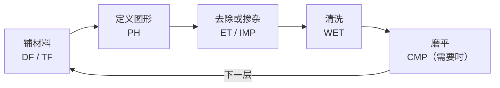

<!-- source: zh-TW/2-process-modules/04-fab-modules/README.md | sha: 3c48565cbac0 -->

# 第 4 章　晶圆厂的七个 Module：谁负责哪一段工艺

> 📍 **晶圆位置**
>
> - 前一站：从沙子到晶圆，一片空白晶圆准备进入晶圆厂
> - **本章：先认识工厂里负责各段工艺的七个 Module**
> - 下一站：光刻，晶圆走进第一个 Module

---

## 为什么要先认识 Module

教科书通常照「技术」分章：氧化、CVD、退火、刻蚀……。晶圆厂则照「部门」分工，这些部门现场叫 **Module**。

这有点像医院。医学课本照器官和疾病分章，医院却分成内科、外科、放射科。同一个病人会在几个科之间来回，每一科只负责自己那一段。

晶圆也一样。它在工厂里要走数百个步骤，每一步都属于某一个 Module。看懂 Module 的分工，就看得懂晶圆的生产流程，也知道出问题时该找谁。

> [!NOTE]
> **📖 名词｜Module（工艺模块）**
>
> - **定义**：晶圆厂里负责某一类工艺的部门，包含设备、工艺工程师与设备工程师。
> - **现场用法**：常用缩写称呼，例如「这站是 DF 的」「这个问题要找 ET」。
> - **相关名词**：Route、Step、Recipe、设备群
> - **常见混淆**：Module 是「部门」，不是「技术」。同一种技术可能分属不同 Module，例如氧化层可以在 DF 长，也可以在 TF 铺。

---

## 七个 Module 一览

| 缩写 | 现场叫法 | 主要工作 | 设备类型 | 本书章节 |
|---|---|---|---|---|
| PH（Photo） | 黄光 | 涂布光刻胶、曝光、显影，定义图形 | 单片式 | [第 5 章](../../2-process-modules/05-lithography/README.md) |
| DF（Diffusion） | 炉管 | 高温氧化、LPCVD、退火 | 批式 | [第 6 章](../../2-process-modules/06-thin-films/README.md)、[第 8 章](../../2-process-modules/08-ion-implantation/README.md) |
| TF（Thin Film） | 薄膜 | PECVD、PVD 溅射、金属 CVD、ALD | 单片式为主 | [第 6 章](../../2-process-modules/06-thin-films/README.md)、[第 11 章](../../2-process-modules/11-metallization/README.md) |
| ET（Etch） | 刻蚀 | 干法刻蚀、去光刻胶 | 单片式 | [第 7 章](../../2-process-modules/07-etching/README.md) |
| IMP（Implant） | 注入 | 把杂质打进硅里 | 单片式为主 | [第 8 章](../../2-process-modules/08-ion-implantation/README.md) |
| CMP | 研磨 | 把晶圆表面磨平 | 单片式 | [第 9 章](../../2-process-modules/09-cmp/README.md) |
| WET | 湿式、清洗 | 清洗、湿法刻蚀、去光刻胶 | 批式与单片式 | [第 10 章](../../2-process-modules/10-cleaning/README.md) |

各公司的分法不完全相同。常见的差异是 IMP 和 DF 合成一个部门，或 WET 并入 DF、ET。测量站有的分给各 Module 自己管，有的另外成立部门。

---

## 每个 Module 在做什么

**PH（黄光）**：晶圆在涂布显影机和曝光机之间自动传送，做完后检查线宽和对准（ADI）。不合格可以去掉光刻胶重做。PH 是唯一能「重来」的 Module。

**DF（炉管）**：把上百片晶圆放进直立的石英炉管，加热几个小时。常见的工艺有：

- **氧化**：长出垫氧化层或较厚的氧化层。
- **LPCVD**：在低压高温下铺上氮化硅、多晶硅或氧化层。
- **退火**：注入后修复晶格，或让铺好的氧化层变得致密。
- **Alloy**：后段完成前，在含氢的气体中低温加热，修补界面缺陷。

**TF（薄膜）**：多半是一次处理一片的腔体设备。用等离子体帮助反应的 PECVD 温度较低，可以在金属层之后使用；PVD 用溅射铺上金属；钨和 ALD 也常在这里。有些公司把电镀铜也归在 TF。

**ET（刻蚀）**：用等离子体依照光刻胶图形把材料挖掉，从沟槽、栅极到接触孔和金属线都有。刻蚀完用氧等离子体烧掉光刻胶，再检查线宽与缺陷（AEI）。

**IMP（注入）**：依剂量和深度，使用不同种类的注入机。注入前通常要先在 PH 做一层光刻胶，挡住不该被打到的区域。

**CMP（研磨）**：把凹凸不平的表面磨平，常见的有氧化层、钨和铜。研磨机内部整合清洗，晶圆干进干出。

**WET（湿式）**：用化学溶液清洗或刻蚀。例如进炉管前的 RCA 清洗、用 HF 去掉氧化层、用热磷酸去掉氮化硅。

> [!NOTE]
> **📖 名词｜炉管（Furnace，现场常称 Diffusion，DF）**
>
> - **定义**：一次处理上百片晶圆的直立式高温设备，负责氧化、LPCVD 与退火。
> - **现场用法**：「这批在等 DF 组批。」「炉管这炉跑完要等降温。」
> - **相关名词**：LPCVD、退火、挡片、组批
> - **常见混淆**：叫「扩散」是历史名称。早期靠高温让杂质扩散进硅里，现代的掺杂大多交给 IMP，炉管已经很少做扩散掺杂。

---

## 同一种技术，可能分属不同 Module

初学者最容易混淆的，是同一个名称出现在好几个 Module：

| 技术 | 可能在哪里做 | 差别 |
|---|---|---|
| 氧化层 | DF 热氧化、DF LPCVD、TF PECVD | 温度、质量与能不能在金属之后使用 |
| 退火 | DF 炉管、RTA 设备 | 炉管时间长；RTA 只需几秒，热预算小 |
| 刻蚀 | ET 干法刻蚀、WET 湿法刻蚀 | 干法刻蚀能做出垂直的细图形；湿法刻蚀快但会往侧面吃 |
| 去光刻胶 | ET 灰化、WET 化学去除 | 常常两者都做：先灰化，再湿式清干净 |

所以看到一个步骤时，要同时看它属于哪个 Module、用什么技术。

---

## 串起来看：一段 Route

以隔离晶体管的 STI（浅沟槽隔离）为例，晶圆会这样在 Module 之间来回：

**DF → DF → PH → ET → WET → TF → DF → CMP → WET**

1. **DF**：长一层薄的垫氧化层，缓冲下一层的应力。
2. **DF**：用 LPCVD 铺上氮化硅，当作硬掩模和研磨的停止层。
3. **PH**：定义沟槽的位置。
4. **ET**：挖出沟槽，再烧掉光刻胶。
5. **WET**：清洗沟槽表面。
6. **TF**：用 CVD 把氧化层填进沟槽。
7. **DF**：退火，让填进去的氧化层变致密。
8. **CMP**：磨掉多出来的氧化层，停在氮化硅上。
9. **WET**：用热磷酸去掉氮化硅。

整座工厂的流程，几乎都是这个循环重复几十次。[第 12 章](../../3-integration/12-cmos-process-flow/README.md)会走完整条 CMOS 流程。

> [!TIP]
> **🔧 Know-how｜发现问题的 Module，不一定是造成问题的 Module**
>
> - **情境**：PH 的 ADI 量到线宽偏移，或 CMP 后发现膜厚不均。
> - **做法**：除了检查发现问题的那一站，也要往前查上几站的履历，例如上一层薄膜的厚度、炉管的位置、清洗后等了多久。
> - **为什么**：每个 Module 都承接前一站的结果。薄膜厚度改变，会影响曝光时的反射；沟槽深度不同，会影响研磨后的高度。
> - **没做会怎样**：只调整发现问题的那一站，等于把上游的问题盖过去。真正的原因还在，下一批会继续出问题。
> - **相关章节**：[第 17 章 良率与失效分析](../../4-yield-and-quality/17-yield-analysis/README.md)、[第 19 章 异常处理与工程变更](../../4-yield-and-quality/19-abnormality-handling/README.md)

> [!TIP]
> **🔧 Know-how｜跨 Module 的交接，是最容易出事的地方**
>
> - **情境**：晶圆在 WET 清洗完，要等 DF 组满一炉才能进炉管。
> - **做法**：两个 Module 一起订好 Q-Time，并且协调派工，让清洗的时间配合炉管组批的时间。
> - **为什么**：每个 Module 都只看得到自己的设备。清洗做得太早，晶圆就在中间等太久。
> - **没做会怎样**：Q-Time 超过，表面重新长出氧化层或沾上污染，晶圆只能重洗，甚至影响电学特性。
> - **相关章节**：[第 10 章 清洗与污染控制](../../2-process-modules/10-cleaning/README.md)、[第 24 章 工厂如何被系统管理](../../6-beyond-the-fab/24-fab-systems/README.md)

---

## 本章重点

1. 教科书照技术分章，晶圆厂照 Module 分工。
2. 七个主要 Module 是 PH、DF、TF、ET、IMP、CMP、WET，各公司的分法略有不同。
3. 炉管（DF）是批式高温设备，负责氧化、LPCVD 与退火。
4. 同一种技术可能分属不同 Module，例如氧化层、退火、刻蚀与去光刻胶。
5. 晶圆反复经过「铺材料、定义图形、去除或掺杂、清洗、磨平」的循环。

---

## 延伸阅读

- Hong Xiao，《Introduction to Semiconductor Manufacturing Technology》，以工艺模块为架构的章节
- Michael Quirk、Julian Serda，《Semiconductor Manufacturing Technology》
- Peter Van Zant，《Microchip Fabrication》

---

[← 上一章：第 3 章 从沙子到晶圆](../../1-fundamentals/03-sand-to-wafer/README.md) ｜ [目录](../../README.md) ｜ [下一章：第 5 章 光刻 →](../../2-process-modules/05-lithography/README.md)
