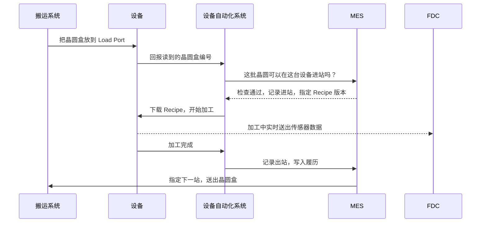

<!-- source: zh-TW/6-beyond-the-fab/23-fab-systems/README.md | sha: 75496740d2fb -->

# 第 23 章　工厂如何被系统管理：一片晶圆为什么不会走错路

> 📍 **晶圆位置**
>
> - 前一站：跟着晶圆走完了整趟旅程
> - **本章：从系统的角度重新看一次工厂**
> - 下一站：芯片出货后，工艺如何影响固件

---

## 一座不可能靠人记住的工厂

想像一下：工厂里同时有数千批晶圆在生产，每一批都要经过数百个步骤；上千台设备各有自己的状态和 Recipe；而且工厂 24 小时不停运转。任何一批晶圆走错一站、用错一个 Recipe，都可能整批报废。

这样的工厂不可能靠人记住一切。现代晶圆厂里，晶圆的每一个动作几乎都由系统指挥和记录，就像机场的塔台和物流中心的结合。

---

## 工厂里的主要系统

| 系统 | 负责什么 | 比喻 |
|---|---|---|
| MES（制造执行系统） | 记录每批晶圆在哪里、下一步是什么，控制每一次进出站 | 工厂的大脑和账本 |
| 设备自动化系统 | 连接设备与 MES，下载 Recipe、启动工艺、收集数据 | 设备的翻译员 |
| 物料搬运系统 | 指挥天车和仓储，把晶圆盒送到正确的位置 | 物流中心 |
| 派工系统 | 决定每台设备下一批要做哪一批晶圆 | 交通信号灯 |
| Recipe 管理系统 | 管理每台设备的 Recipe 和版本 | 食谱数据库 |
| 工艺控制系统 | SPC、FDC、R2R，监控与控制工艺质量 | 质量控制员 |
| 良率分析系统 | 集成工艺和测试数据，分析良率 | 侦探 |

> [!NOTE]
> **📖 名词｜MES（Manufacturing Execution System，制造执行系统）**
>
> - **定义**：管理生产现场的核心系统，记录每批晶圆的位置、状态与历程，并控制晶圆能不能进入下一个步骤。
> - **现场用法**：「MES 上这批显示 Hold，要先查原因。」
> - **相关名词**：Track-in、Track-out、Route、Hold、派工
> - **常见混淆**：MES 不等于工厂的所有系统。它是核心，但设备连接、搬运、派工、工艺控制通常由其他系统负责，彼此互相配合。

---

## 一批晶圆到站时，发生了什么事

以一批晶圆抵达一台刻蚀机为例：

1. 天车把晶圆盒放到设备的 Load Port，设备读取晶圆盒上的编号。
2. 系统逐一确认：这批晶圆现在应该在这一站吗？这台设备可以做这个产品吗？设备状态正常吗？晶圆有没有被 Hold？Q-Time 有没有超过？晶圆盒的污染等级和设备相符吗？
3. 全部确认通过后，系统把正确版本的 Recipe 下载到设备，并记录**进站**。
4. 设备开始加工，同时把传感器数据实时送给 FDC 监控。
5. 加工完成后记录**出站**，把使用的设备、腔体、Recipe、时间等数据写入这批晶圆的履历。
6. 系统决定下一站，搬运系统把晶圆盒送过去，或先送进仓储等待。

> [!NOTE]
> **📖 名词｜进站与出站（Track-in / Track-out）**
>
> - **定义**：进站是晶圆开始在某一站加工时，在系统上的登记；出站是完成加工后的登记，并把晶圆推进到下一个步骤。
> - **现场用法**：「这批进站之后设备就 Down 了，要处理一下帐。」
> - **相关名词**：MES、Route、履历
> - **常见混淆**：系统上的状态和实物晶圆必须一致。系统显示已出站、但晶圆其实还没做完，就是现场说的「账实不符」，必须立即处理。

设备来自世界各地不同的厂商，为了让系统能用同样的方式和每一台设备沟通，产业制定了共同的通信标准，最常见的是 **SECS/GEM**。它就像设备与系统之间的共同语言。

---

## 防呆：让错误无法发生

上面第 2 步的每一项确认，都是一条**防呆规则**。例如：

- 晶圆不在这一站，就不能进站。
- 设备没有通过验证，就不能做这个产品。
- Recipe 版本不对，就不能开始。
- Q-Time 超过、或晶圆被 Hold，就不能继续。
- 接触过铜的晶圆盒，不能放上前段的设备。

以前很多确认靠人工核对，现在则写成系统规则，由系统自动挡下。人会疲倦、会分心，但系统每一次都会检查。

> [!TIP]
> **🔧 Know-how｜每一条防呆规则背后，通常都有一次事故**
>
> - **情境**：急件赶着出货，有人希望暂时跳过某个系统检查。
> - **做法**：例外处理必须经过正式的申请和核准，并且留下记录，事后也要检讨规则是否需要调整。
> - **为什么**：很多规则都是从过去的事故学来的。规则看起来麻烦，往往是因为它挡下的错误很少再发生，大家已经忘了它为什么存在。
> - **没做会怎样**：同样的事故再次发生，而且因为规则被跳过，事后也很难追查。
> - **相关章节**：[第 18 章 异常处理与工程变更](../../4-yield-and-quality/18-abnormality-handling/README.md)

---

## 履历：每一片晶圆的完整记录

系统会为每一片晶圆留下完整的**履历**：经过哪些步骤、用了哪台设备和腔体、哪个 Recipe 版本、什么时间、测量结果是多少。

这些记录是整座工厂的记忆，用在很多地方：

- 良率异常时，做共因分析，找出共同点，见[第 16 章](../../4-yield-and-quality/16-yield-analysis/README.md)。
- 设备出问题时，找出受影响的范围，见[第 18 章](../../4-yield-and-quality/18-abnormality-handling/README.md)。
- 客户回报问题时，从一颗芯片一路追溯到它的晶圆、批次和每一站的生产条件。

---

## 数据与智能制造

一座晶圆厂每天产生的数据量非常庞大，包括设备传感器的数据、测量结果、测试结果和生产记录。这些数据正被用来做更多事情：

- **预测性维护**：从设备数据的变化，预测零件什么时候需要更换。
- **虚拟测量**：根据设备在加工时的数据，推估测量结果，减少实际测量的次数。
- **人工智能分析**：自动辨识晶圆图的形态、找出良率损失的原因。
- **自动化派工**：根据实时状态，自动决定最佳的生产顺序。

> [!TIP]
> **🔧 Know-how｜系统停摆，工厂就停摆**
>
> - **情境**：MES 突然宕机。
> - **做法**：核心系统采用冗余备份架构，系统的修改要经过完整测试，并安排在影响最小的时段上线；工厂也会事先准备系统停摆时的应急程序。
> - **为什么**：晶圆的每一次进出站都要经过系统，系统一停，设备就算正常也无法继续生产。
> - **没做会怎样**：整座工厂停线，正在等待的晶圆还可能因为超过 Q-Time 而需要返工或报废。
> - **相关章节**：[第 9 章 清洗与污染控制](../../2-process-modules/09-cleaning/README.md)

---

## 本章重点

1. 晶圆厂的复杂度远超过人力能掌握，每一个动作都由系统指挥和记录。
2. MES 是核心，搭配设备自动化、搬运、派工、Recipe 管理和工艺控制等系统。
3. 晶圆进站前，系统会检查步骤、设备、Recipe、Q-Time、Hold 和污染等级。
4. 每片晶圆的完整履历，是良率分析、异常处理和客户追溯的基础。
5. 工厂数据正被用在预测性维护、虚拟测量和人工智能分析上。

---

## 延伸阅读

- Heiko Meyer、Franz Fuchs、Klaus Thiel，《Manufacturing Execution Systems: Optimal Design, Planning, and Deployment》
- Wallace J. Hopp、Mark L. Spearman，《Factory Physics》
- SEMI 的设备通信相关标准（SECS/GEM）

---

[← 上一章：第 22 章 最终测试与可靠性](../../5-backend/22-final-test-and-reliability/README.md) ｜ [目录](../../README.md) ｜ [下一章：第 24 章 工艺如何影响固件 →](../../6-beyond-the-fab/24-process-and-firmware/README.md)
