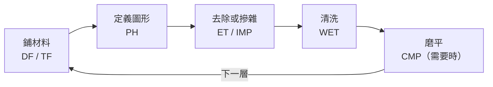

# 第 4 章　晶圓廠的七個 Module：誰負責哪一段製程

> 📍 **晶圓位置**
>
> - 前一站：從沙子到晶圓，一片空白晶圓準備進入晶圓廠
> - **本章：先認識工廠裡負責各段製程的七個 Module**
> - 下一站：微影，晶圓走進第一個 Module

---

## 為什麼要先認識 Module

教科書通常照「技術」分章：氧化、CVD、退火、蝕刻……。晶圓廠則照「部門」分工，這些部門現場叫 **Module**。

這有點像醫院。醫學課本照器官和疾病分章，醫院卻分成內科、外科、放射科。同一個病人會在幾個科之間來回，每一科只負責自己那一段。

晶圓也一樣。它在工廠裡要走數百個步驟，每一步都屬於某一個 Module。看懂 Module 的分工，就看得懂晶圓的生產流程，也知道出問題時該找誰。

> [!NOTE]
> **📖 名詞｜Module（製程模組）**
>
> - **定義**：晶圓廠裡負責某一類製程的部門，包含機台、製程工程師與設備工程師。
> - **現場用法**：常用縮寫稱呼，例如「這站是 DF 的」「這個問題要找 ET」。
> - **相關名詞**：Route、Step、Recipe、機台群
> - **常見混淆**：Module 是「部門」，不是「技術」。同一種技術可能分屬不同 Module，例如氧化層可以在 DF 長，也可以在 TF 鋪。

---

## 七個 Module 一覽

| 縮寫 | 現場叫法 | 主要工作 | 機台型態 | 本書章節 |
|---|---|---|---|---|
| PH（Photo） | 黃光 | 塗佈光阻、曝光、顯影，定義圖形 | 單片式 | [第 5 章](../../2-process-modules/05-lithography/README.md) |
| DF（Diffusion） | 爐管 | 高溫氧化、LPCVD、退火 | 批次式 | [第 6 章](../../2-process-modules/06-thin-films/README.md)、[第 8 章](../../2-process-modules/08-ion-implantation/README.md) |
| TF（Thin Film） | 薄膜 | PECVD、PVD 濺鍍、金屬 CVD、ALD | 單片式為主 | [第 6 章](../../2-process-modules/06-thin-films/README.md)、[第 11 章](../../2-process-modules/11-metallization/README.md) |
| ET（Etch） | 蝕刻 | 乾蝕刻、去光阻 | 單片式 | [第 7 章](../../2-process-modules/07-etching/README.md) |
| IMP（Implant） | 佈植 | 把雜質打進矽裡 | 單片式為主 | [第 8 章](../../2-process-modules/08-ion-implantation/README.md) |
| CMP | 研磨 | 把晶圓表面磨平 | 單片式 | [第 9 章](../../2-process-modules/09-cmp/README.md) |
| WET | 濕式、清洗 | 清洗、濕蝕刻、去光阻 | 批次式與單片式 | [第 10 章](../../2-process-modules/10-cleaning/README.md) |

各公司的分法不完全相同。常見的差異是 IMP 和 DF 合成一個部門，或 WET 併入 DF、ET。量測站有的分給各 Module 自己管，有的另外成立部門。

---

## 每個 Module 在做什麼

**PH（黃光）**：晶圓在塗佈顯影機和曝光機之間自動傳送，做完後檢查線寬和對準（ADI）。不合格可以去掉光阻重做。PH 是唯一能「重來」的 Module。

**DF（爐管）**：把上百片晶圓放進直立的石英爐管，加熱幾個小時。常見的製程有：

- **氧化**：長出墊氧化層或較厚的氧化層。
- **LPCVD**：在低壓高溫下鋪上氮化矽、多晶矽或氧化層。
- **退火**：佈植後修復晶格，或讓鋪好的氧化層變得緻密。
- **Alloy**：後段完成前，在含氫的氣體中低溫加熱，修補介面缺陷。

**TF（薄膜）**：多半是一次處理一片的腔體機台。用電漿幫助反應的 PECVD 溫度較低，可以在金屬層之後使用；PVD 用濺鍍鋪上金屬；鎢和 ALD 也常在這裡。有些公司把電鍍銅也歸在 TF。

**ET（蝕刻）**：用電漿依照光阻圖形把材料挖掉，從溝槽、閘極到接觸窗和金屬線都有。蝕刻完用氧電漿燒掉光阻，再檢查線寬與缺陷（AEI）。

**IMP（佈植）**：依劑量和深度，使用不同種類的佈植機。佈植前通常要先在 PH 做一層光阻，擋住不該被打到的區域。

**CMP（研磨）**：把凹凸不平的表面磨平，常見的有氧化層、鎢和銅。研磨機內部整合清洗，晶圓乾進乾出。

**WET（濕式）**：用化學溶液清洗或蝕刻。例如進爐管前的 RCA 清洗、用 HF 去掉氧化層、用熱磷酸去掉氮化矽。

> [!NOTE]
> **📖 名詞｜爐管（Furnace，現場常稱 Diffusion，DF）**
>
> - **定義**：一次處理上百片晶圓的直立式高溫機台，負責氧化、LPCVD 與退火。
> - **現場用法**：「這批在等 DF 組批。」「爐管這爐跑完要等降溫。」
> - **相關名詞**：LPCVD、退火、擋片、組批
> - **常見混淆**：叫「擴散」是歷史名稱。早期靠高溫讓雜質擴散進矽裡，現代的摻雜大多交給 IMP，爐管已經很少做擴散摻雜。

---

## 同一種技術，可能分屬不同 Module

初學者最容易混淆的，是同一個名稱出現在好幾個 Module：

| 技術 | 可能在哪裡做 | 差別 |
|---|---|---|
| 氧化層 | DF 熱氧化、DF LPCVD、TF PECVD | 溫度、品質與能不能在金屬之後使用 |
| 退火 | DF 爐管、RTA 機台 | 爐管時間長；RTA 只需幾秒，熱預算小 |
| 蝕刻 | ET 乾蝕刻、WET 濕蝕刻 | 乾蝕刻能做出垂直的細圖形；濕蝕刻快但會往側面吃 |
| 去光阻 | ET 灰化、WET 化學去除 | 常常兩者都做：先灰化，再濕式清乾淨 |

所以看到一個步驟時，要同時看它屬於哪個 Module、用什麼技術。

---

## 串起來看：一段 Route

以隔離電晶體的 STI（淺溝槽隔離）為例，晶圓會這樣在 Module 之間來回：

**DF → DF → PH → ET → WET → TF → DF → CMP → WET**

1. **DF**：長一層薄的墊氧化層，緩衝下一層的應力。
2. **DF**：用 LPCVD 鋪上氮化矽，當作硬遮罩和研磨的停止層。
3. **PH**：定義溝槽的位置。
4. **ET**：挖出溝槽，再燒掉光阻。
5. **WET**：清洗溝槽表面。
6. **TF**：用 CVD 把氧化層填進溝槽。
7. **DF**：退火，讓填進去的氧化層變緻密。
8. **CMP**：磨掉多出來的氧化層，停在氮化矽上。
9. **WET**：用熱磷酸去掉氮化矽。

整座工廠的流程，幾乎都是這個循環重複幾十次。[第 12 章](../../3-integration/12-cmos-process-flow/README.md)會走完整條 CMOS 流程。

> [!TIP]
> **🔧 Know-how｜發現問題的 Module，不一定是造成問題的 Module**
>
> - **情境**：PH 的 ADI 量到線寬偏移，或 CMP 後發現膜厚不均。
> - **做法**：除了檢查發現問題的那一站，也要往前查上幾站的履歷，例如上一層薄膜的厚度、爐管的位置、清洗後等了多久。
> - **為什麼**：每個 Module 都承接前一站的結果。薄膜厚度改變，會影響曝光時的反射；溝槽深度不同，會影響研磨後的高度。
> - **沒做會怎樣**：只調整發現問題的那一站，等於把上游的問題蓋過去。真正的原因還在，下一批會繼續出問題。
> - **相關章節**：[第 17 章 良率與故障分析](../../4-yield-and-quality/17-yield-analysis/README.md)、[第 19 章 異常處理與工程變更](../../4-yield-and-quality/19-abnormality-handling/README.md)

> [!TIP]
> **🔧 Know-how｜跨 Module 的交接，是最容易出事的地方**
>
> - **情境**：晶圓在 WET 清洗完，要等 DF 組滿一爐才能進爐管。
> - **做法**：兩個 Module 一起訂好 Q-Time，並且協調派工，讓清洗的時間配合爐管組批的時間。
> - **為什麼**：每個 Module 都只看得到自己的機台。清洗做得太早，晶圓就在中間等太久。
> - **沒做會怎樣**：Q-Time 超過，表面重新長出氧化層或沾上污染，晶圓只能重洗，甚至影響電性。
> - **相關章節**：[第 10 章 清洗與污染控制](../../2-process-modules/10-cleaning/README.md)、[第 24 章 工廠如何被系統管理](../../6-beyond-the-fab/24-fab-systems/README.md)

---

## 本章重點

1. 教科書照技術分章，晶圓廠照 Module 分工。
2. 七個主要 Module 是 PH、DF、TF、ET、IMP、CMP、WET，各公司的分法略有不同。
3. 爐管（DF）是批次式高溫機台，負責氧化、LPCVD 與退火。
4. 同一種技術可能分屬不同 Module，例如氧化層、退火、蝕刻與去光阻。
5. 晶圓反覆經過「鋪材料、定義圖形、去除或摻雜、清洗、磨平」的循環。

---

## 延伸閱讀

- Hong Xiao，《Introduction to Semiconductor Manufacturing Technology》，以製程模組為架構的章節
- Michael Quirk、Julian Serda，《Semiconductor Manufacturing Technology》
- Peter Van Zant，《Microchip Fabrication》

---

[← 上一章：第 3 章 從沙子到晶圓](../../1-fundamentals/03-sand-to-wafer/README.md) ｜ [目錄](../../README.md) ｜ [下一章：第 5 章 微影 →](../../2-process-modules/05-lithography/README.md)
