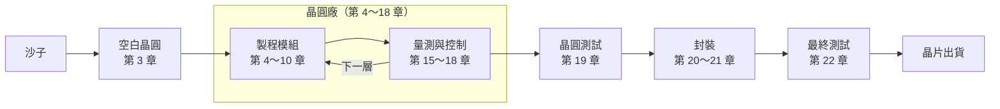

# 半導體製造概論

**跟著一片晶圓，走完從沙子到晶片的旅程**

🌐 [簡體中文](../zh-CN/README.md) ｜ **繁體中文** ｜ [English](../en/README.md) ｜ [日本語](../ja/README.md) ｜ [한국어](../ko/README.md) ｜ [總覽首頁](../README.md)

---

## 這本書在講什麼

一顆指甲大小的晶片上，有數十億個電晶體。它們全部是在一片薄薄的矽晶圓上，經過數百到上千個步驟、花上好幾個月「做」出來的。

這本書會跟著**一片晶圓**，從沙子開始，一站一站走進晶圓廠，經過微影、薄膜、蝕刻、佈植、研磨與金屬化，再到測試、封裝，最後變成可以裝進手機和電腦的晶片。

書裡不談艱深的物理和公式，而是專注在三件事：

- **流程**：每一步在做什麼，為什麼要這樣做，順序為什麼這樣排。
- **名詞**：中英對照，以及在晶圓廠裡實際怎麼使用這些詞。
- **Know-how**：教科書不太寫、但在現場一定會遇到的事。

## 適合誰讀

- 想知道晶片怎麼做出來的理工背景讀者，例如軟體、韌體、電機工程師與學生。
- 準備進入半導體業的新人，想先熟悉製造流程和現場用語。
- 已經在半導體業工作，但只熟悉自己負責的那一段，想看看全貌的人。

不需要半導體物理或化學背景，高中程度的理化知識就足夠了。

## 每一章都有的三個小幫手

| 標示 | 內容 |
|---|---|
| 📍 晶圓位置 | 晶圓現在走到旅程的哪一站，前一站和下一站是什麼 |
| 📖 名詞框 | 定義、現場用法、相關名詞，以及最容易搞混的地方 |
| 🔧 Know-how 框 | 現場的做法，以及「為什麼要這樣做、沒做會怎樣」 |

例如第 4 章微影裡的一個 Know-how 框：

> [!TIP]
> **🔧 Know-how｜微影是「可以重來」的最後機會**
>
> - **情境**：檢查發現圖形尺寸或對準不合格。
> - **做法**：把光阻全部去掉，重新塗佈、曝光，這叫 **Rework**。
> - **為什麼**：這時晶圓上只多了一層光阻，底下的材料還沒被動過。
> - **沒做會怎樣**：一旦進入蝕刻，錯誤的圖形就會永久刻進材料裡，晶圓可能只能報廢。

---

## 全書地圖

晶圓在晶圓廠裡，會反覆經過「鋪材料、微影、蝕刻或佈植、清洗、量測」的循環，一層一層往上蓋。第 11～14 章把這些模組串成完整的流程，第 23、24 章則從系統和韌體的角度，重新看一次整趟旅程。

---

## 目錄

### 第 0 部　開始之前

| 章節 | 你會讀到 |
|---|---|
| [第 0 章　半導體製造全景](0-before-you-start/00-overview/README.md) | 一顆晶片從設計到出貨的旅程，以及產業如何分工 |
| [第 1 章　晶圓廠如何運作](0-before-you-start/01-how-a-fab-works/README.md) | 無塵室、自動搬運、機台、廠務，以及工廠裡的各種職務 |

### 第 1 部　基礎

| 章節 | 你會讀到 |
|---|---|
| [第 2 章　從物理到電晶體](1-fundamentals/02-transistor-basics/README.md) | 半導體、摻雜、MOSFET 與 CMOS，只講製程需要的程度 |
| [第 3 章　從沙子到晶圓](1-fundamentals/03-sand-to-wafer/README.md) | 純化、長晶、切片與拋光，做出一片完美的空白晶圓 |

### 第 2 部　製程模組

| 章節 | 你會讀到 |
|---|---|
| [第 4 章　微影](2-process-modules/04-lithography/README.md) | 光罩、光阻與曝光機，把電路圖「印」到晶圓上 |
| [第 5 章　薄膜](2-process-modules/05-thin-films/README.md) | 熱氧化、CVD、PVD、ALD 與磊晶 |
| [第 6 章　蝕刻](2-process-modules/06-etching/README.md) | 乾蝕刻與濕蝕刻、電漿、選擇比與終點偵測 |
| [第 7 章　離子佈植與熱處理](2-process-modules/07-ion-implantation/README.md) | 劑量、能量、退火與熱預算 |
| [第 8 章　CMP](2-process-modules/08-cmp/README.md) | 把晶圓磨平：研磨液、碟化、侵蝕與假圖形 |
| [第 9 章　清洗與污染控制](2-process-modules/09-cleaning/README.md) | RCA 清洗、Q-Time 與交叉污染 |
| [第 10 章　金屬化](2-process-modules/10-metallization/README.md) | 接觸窗、銅的大馬士革製程與低介電常數材料 |

### 第 3 部　製程整合

| 章節 | 你會讀到 |
|---|---|
| [第 11 章　走一遍完整的 CMOS 流程](3-integration/11-cmos-process-flow/README.md) | FEOL、MOL、BEOL 與光罩層數 |
| [第 12 章　先進電晶體結構](3-integration/12-advanced-transistors/README.md) | FinFET、GAA 與背面供電 |
| [第 13 章　記憶體製程](3-integration/13-memory/README.md) | DRAM、3D NAND 與 HBM |
| [第 14 章　「幾奈米」是什麼意思](3-integration/14-process-nodes/README.md) | 製程節點、間距與電晶體密度 |

### 第 4 部　品質與良率

| 章節 | 你會讀到 |
|---|---|
| [第 15 章　量測與檢測](4-yield-and-quality/15-metrology/README.md) | 膜厚、線寬、對準與缺陷檢測，以及抽樣 |
| [第 16 章　良率與故障分析](4-yield-and-quality/16-yield-analysis/README.md) | 晶圓圖判讀、共通性分析與故障分析 |
| [第 17 章　製程控制](4-yield-and-quality/17-process-control/README.md) | SPC、Cpk、R2R 與 FDC |
| [第 18 章　異常處理與工程變更](4-yield-and-quality/18-abnormality-handling/README.md) | OCAP、Hold、MRB 與變更管理 |

### 第 5 部　後段：測試與封裝

| 章節 | 你會讀到 |
|---|---|
| [第 19 章　晶圓測試](5-backend/19-wafer-test/README.md) | WAT 與 CP，找出好的晶粒 |
| [第 20 章　封裝](5-backend/20-packaging/README.md) | 切割、打線、覆晶與常見的封裝形式 |
| [第 21 章　先進封裝](5-backend/21-advanced-packaging/README.md) | 2.5D、3D 堆疊、混合鍵合與 Chiplet |
| [第 22 章　最終測試與可靠度](5-backend/22-final-test-and-reliability/README.md) | 預燒、浴缸曲線、可靠度測試與失效機制 |

### 第 6 部　走出晶圓廠

| 章節 | 你會讀到 |
|---|---|
| [第 23 章　工廠如何被系統管理](6-beyond-the-fab/23-fab-systems/README.md) | MES、機台自動化、防呆與晶圓履歷 |
| [第 24 章　製程如何影響韌體](6-beyond-the-fab/24-process-and-firmware/README.md) | DRAM 刷新、Row Hammer、ECC、NAND 與晶片改版 |

### 附錄

| 附錄 | 你會讀到 |
|---|---|
| [附錄 A　術語總表](appendix/glossary.md) | 兩百多個術語的中英對照與縮寫，也是全書用詞的依據 |
| [附錄 B　現場行話](appendix/fab-jargon.md) | 晶圓廠裡常聽到的說法與例句 |
| [附錄 C　延伸閱讀](appendix/further-reading.md) | 教科書、產業標準與研討會 |

---

## 閱讀路線

依序閱讀是最完整的方式，但你也可以依照自己的需要，選一條路線開始：

| 路線 | 建議章節 |
|---|---|
| 🚀 快速認識全貌 | 第 0、1、11、14 章 |
| 💻 軟體與韌體工程師 | 第 0、2、11、13、14、22、23、24 章 |
| 🏭 準備進入半導體業 | 依序讀完全書，特別留意第 1、11、15～18 章與附錄 B |
| 📦 對封裝與測試有興趣 | 第 0、11、19～22 章 |

---

## 參與這個專案

這本書是開放的專案，歡迎一起把它變得更好：

- **發現錯誤**：請到本專案的 [Issues](../../../issues) 頁面，使用「勘誤回報」範本告訴我們。
- **補充內容或圖片**：請先閱讀[貢獻指南](../CONTRIBUTING.md)和[寫作規範](../STYLE_GUIDE.md)。
- **翻譯成其他語言**：請閱讀[翻譯指南](../TRANSLATIONS.md)。

如果這本書對你有幫助，歡迎按下右上角的 ⭐ Star，讓更多人看到它。

---

## 免責聲明

- 本書內容整理自公開資料與業界通用的知識，不包含任何公司的機密資訊、特定製程參數或內部作業流程。
- 本書與任何半導體公司都沒有隸屬關係，書中使用的都是業界通用的技術名稱。
- 書中的數字多半是量級或概略值，實際數值依製程、產品與公司而不同。
- 內容如有錯誤或過時之處，歡迎透過 Issue 指正。

## 授權

本書的文字與圖片採用 [創用 CC 姓名標示－非商業性－相同方式分享 4.0 國際](../LICENSE)（CC BY-NC-SA 4.0）授權。只要註明出處、不用於商業目的，並以相同的授權方式分享，就可以自由轉載、改編與翻譯。
